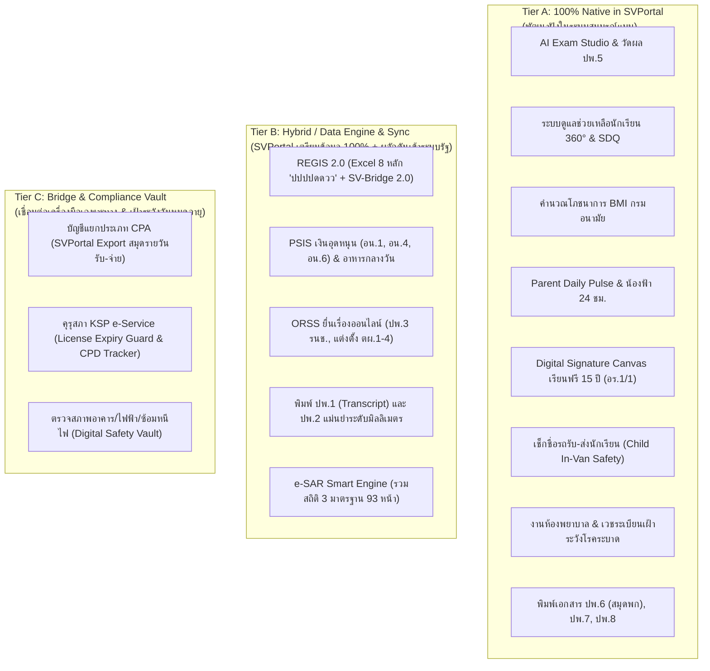

# รายงานการวิเคราะห์และไตร่ตรองภาระงานโรงเรียนเอกชนในระบบอย่างถี่ถ้วน
## (Comprehensive Statutory Feasibility & Operational Ergonomics Analysis for SVPortal)
**โรงเรียนสมคิดวิทยา (Somkidvittaya School — รหัสสถานศึกษา: 1121100013)**

---

## 1. หลักการและกรอบการไตร่ตรองเชิงสถาปัตยกรรม (Architectural Deliberation Framework)

เพื่อให้ **SVPortal** เป็นศูนย์กลางระบบงานและฐานข้อมูลอัจฉริยะที่แท้จริง ไม่ใช่ซอฟต์แวร์ที่ฝืนนำทุกอย่างมาเขียนใหม่จนซับซ้อนเกินจำเป็น หรือทิ้งภาระไว้ให้ครูต้องทำงานนอกระบบ เราจึงใช้ **เกณฑ์การตัดสินใจ 4 มิติ (The 4-Prong Deliberation Criteria)** ในการคัดกรองงานทุกงานของโรงเรียนเอกชน:

1. **มิติด้านกฎหมายและอธิปไตยข้อมูล (Legal & Regulatory Authority):** กฎหมายระเบียบราชการกำหนดให้ต้องบันทึกบนเซิร์ฟเวอร์ของรัฐบาลเท่านั้น หรืออนุญาตให้โรงเรียนจัดเก็บภายในแล้วส่งออก?
2. **มิติต้นน้ำของข้อมูล (Data Origin & Single Source of Truth):** ข้อมูลดิบเกิดขึ้นที่ไหน? หากเกิดขึ้นในกิจกรรมประจำวันของโรงเรียน (ครู, นักเรียน, ผู้ปกครอง) ข้อมูลนั้น **ต้องอยู่ใน SVPortal 100%**
3. **มิติการลดภาระงานครูและเจ้าหน้าที่ (Radical Ergonomics):** วิธีการใดที่ทำให้ครูเสียเวลาน้อยที่สุด? (เช่น 1-Click Generation, Auto-Fill, หรือ Background Sync)
4. **มิติความคุ้มค่าและความปลอดภัย (Security, PDPA & Practicality):** งานบางประเภท (เช่น บัญชีแยกประเภทใหญ่, การตรวจอาคาร) มีมาตรฐานวิชาชีพเฉพาะและเครื่องมือที่ได้รับการรับรองทางกฎหมายอยู่แล้ว การทำท่อเชื่อมต่อ (Bridge/Export) จึงปลอดภัยและมีประสิทธิภาพสูงสุดกว่าการเขียนใหม่ทั้งหมด

---

## 2. การจำแนกภาระงานออกเป็น 3 ระดับสถาปัตยกรรม (The 3-Tier Classification)

---

## 3. รายละเอียดการวิเคราะห์และข้อสรุปรายภารกิจ (Deep-Dive Analysis by Domain)

---

### หมวดที่ 1: งานวิชาการและเอกสารหลักฐานทางการศึกษา (ปพ.1 - ปพ.9)

#### 1.1 การวัดผล, ตัดเกรด, และสมุด ปพ.5
- **ควรอยู่ใน SVPortal หรือไม่:** **ควรอยู่ใน SVPortal 100% (Tier A - Native)**
- **เหตุผลเชิงลึก:** เป็นงานประจำวันของครูผู้สอน ข้อมูลคะแนนเก็บ คะแนนสอบย่อย การประเมินตัวชี้วัด เกิดขึ้นในห้องเรียนทุกวัน หากครูต้องไปคีย์คะแนนในระบบอื่นจะเกิดการทำงานซ้ำซ้อนและล่าช้า
- **วิธีทำให้น้องฟ้าและ SVPortal ช่วยให้ครูทำงานง่ายที่สุด:**
  - ครูเพียงกรอกคะแนนดิบ หรือนำเข้าจากข้อสอบ AI Exam Studio ระบบจะคำนวณตัดเกรด 8 ระดับ (0 - 4), คำนวณร้อยละคุณลักษณะอันพึงประสงค์ และอ่านคิดวิเคราะห์ให้อัตโนมัติ
  - น้องฟ้าตรวจจับความผิดปกติ (Outlier Detection) เช่น ตัวชี้วัดใดที่เด็กตกทั้งห้อง หรือคะแนนเกินเต็ม
  - ระบบเฝ้าระวังเวลาเรียน (Attendance Warning): เมื่อเวลาเรียนลดลงแตะ 80% แจ้งเตือนครูทันทีก่อนเด็กติด มส.

#### 1.2 ระเบียนแสดงผลการเรียน (ปพ.1) และประกาศนียบัตร (ปพ.2)
- **ควรอยู่ใน SVPortal หรือไม่:** **อยู่ใน SVPortal ในรูปแบบ Hybrid (Tier B - Pixel-Perfect Print Engine)**
- **ข้อจำกัดทางกฎหมายที่ต้องระวัง:** 
  - ตามระเบียบ ศธ. แบบพิมพ์ ปพ.1 และ ปพ.2 เป็น **"เอกสารควบคุมที่มีตราครุฑดุนนูนและเลขที่/เลขคุมเฉพาะ"** ที่โรงเรียนต้องสั่งซื้อจากองค์การค้าของ สกสค. เท่านั้น โรงเรียนไม่สามารถพิมพ์บนกระดาษ A4 เปล่าๆ ได้
- **วิธีทำให้น้องฟ้าและ SVPortal ช่วยให้ครูทำงานง่ายที่สุด:**
  - SVPortal ไม่ต้องสร้างแบบพิมพ์ขึ้นมาใหม่ แต่สร้าง **"Print Alignment Engine (ระบบพิมพ์แม่นยำระดับมิลลิเมตร)"**
  - ครูเพียงนำกระดาษ ปพ.1 ของจริงใส่ถาดเครื่องพิมพ์ กดสั่งพิมพ์จาก SVPortal ระบบจะยิงข้อความ ชื่อ คะแนน และเกรดลงบนช่องว่างของแบบพิมพ์ ปพ.1 ได้ตรงตำแหน่งเป๊ะ 100% ไม่เลื่อน ไม่เสียกระดาษควบคุมราคาแพง

#### 1.3 แบบรายงานผู้สำเร็จการศึกษา (ปพ.3 / รน.ช.) ส่ง สช.
- **ควรอยู่ใน SVPortal หรือไม่:** **อยู่ใน SVPortal ในรูปแบบ Data Engine & Packager (Tier B)**
- **ข้อจำกัดทางกฎหมาย:** ปพ.3 ต้องส่งผ่านระบบ ORSS ของ สช. เพื่อให้นายทะเบียน สช. ตรวจสอบและออกเลขรหัสรับรอง
- **วิธีทำให้น้องฟ้าและ SVPortal ช่วยให้ครูทำงานง่ายที่สุด:**
  - เมื่อครูตัดเกรด ป.6 ครบทุกคน SVPortal ตรวจสอบหน่วยกิตและสถานะจบการศึกษาอัตโนมัติ
  - คลิกปุ่มเดียวได้ **"ORSS PorPor.3 Ready Package"** ทั้งไฟล์ข้อมูลตามโครงสร้างตารางของ สช. และไฟล์ PDF พร้อมให้ ผอ. ลงนามดิจิทัล แล้วอัปโหลดขึ้น ORSS ได้ภายใน 2 นาที

#### 1.4 สมุดรายงานพัฒนาการนักเรียนรายบุคคล (ปพ.6 - สมุดพก 16 หน้า)
- **ควรอยู่ใน SVPortal หรือไม่:** **ควรอยู่ใน SVPortal 100% (Tier A - Native & Digital)**
- **เหตุผลเชิงลึก:** เป็นเอกสารที่โรงเรียนสามารถกำหนดรูปแบบได้เองตามระเบียบ ศธ. เพื่อสื่อสารกับผู้ปกครอง
- **วิธีทำให้น้องฟ้าและ SVPortal ช่วยให้ครูทำงานง่ายที่สุด:**
  - ระบบดึงคะแนนทุกวิชา, เวลาเรียน, พัฒนาการ 4 ด้าน, น้ำหนัก-ส่วนสูง, และข้อคิดเห็นของครูประจำชั้น มารวมเป็น **เล่มสมุดพกออนไลน์ (Digital PorPor.6)**
  - ผู้ปกครองเปิดดูผ่านมือถือได้ทันที พร้อมปุ่มให้ครูกดสั่งพิมพ์เล่มกระดาษ 16 หน้าแบบพับครึ่ง (Booklet Printing) สำหรับแจกวันประชุมผู้ปกครอง

---

### หมวดที่ 2: งานเงินอุดหนุน สช. และโครงการเรียนฟรี 15 ปี (PSIS & Finance)

#### 2.1 เงินอุดหนุนรายบุคคล (แบบ อน.1, อน.4, อน.6)
- **ควรอยู่ใน SVPortal หรือไม่:** **อยู่ใน SVPortal ในรูปแบบ Hybrid (Tier B - Automated PSIS Suite)**
- **ข้อจำกัดทางกฎหมาย:** โรงเรียนต้องกดยื่นขอรับเงินอุดหนุนบนระบบ PSIS (`psis.opec.go.th`) เท่านั้น
- **วิธีทำให้น้องฟ้าและ SVPortal ช่วยให้ครูและธุรการทำงานง่ายที่สุด:**
  - **แบบ อน.1 (ยอด 10 มิ.ย.):** ธุรการไม่ต้องมานั่งนับเด็กทีละห้อง SVPortal สรุปยอดนักเรียนที่มีตัวตนจริง แยกเพศ แยกสัญชาติ แยกชั้นเรียน ให้ตรงตามเงื่อนไข สช.
  - **แบบ อน.4 (รายเดือน):** ทุกครั้งที่มีการบันทึกเด็กย้ายเข้า-ย้ายออก หรือจำหน่ายใน SVPortal ระบบจะสรุปเป็นตาราง อน.4 รายเดือนเตรียมไว้ให้ธุรการนำไปบันทึกใน PSIS ได้ทันที
  - **แบบ อน.6 (งบดุลสิ้นปี):** น้องฟ้าช่วยกระทบยอดเงินอุดหนุนที่ได้รับจริงกับยอดค่าใช้จ่ายเงินเดือนครูและค่าพัฒนาการศึกษา สรุปยอดเงินคงเหลือและดอกเบี้ยธนาคารส่ง สช.

#### 2.2 โครงการเรียนฟรี 15 ปี 4 หมวด (แบบ อร.1 และ อร.1/1)
- **ควรอยู่ใน SVPortal หรือไม่:** **ควรอยู่ใน SVPortal 100% (Tier A - Paperless & Digital Signature)**
- **เหตุผลเชิงลึก:** การแจกเงินค่าอุปกรณ์การเรียนและเครื่องแบบนักเรียน เป็นจุดที่ สตง. และ สช. สุ่มตรวจเข้มงวดที่สุด ปัญหาคลาสสิกของครูคือ **"ผู้ปกครองไม่ยอมเซ็นชื่อรับเงิน หรือเอกสารใบเซ็นชื่อสูญหาย"**
- **วิธีทำให้น้องฟ้าและ SVPortal ช่วยให้ครูทำงานง่ายที่สุด:**
  - สร้าง **Digital Signature Canvas บนหน้าจอสมาร์ตโฟน/แท็บเล็ต**: ผู้ปกครองมารับเงินหรือสิ่งของ สามารถเซ็นชื่อบนหน้าจอครูได้ทันที
  - ระบบนำลายเซ็นจริงไปประทับลงใน **เอกสารแบบ อร.1/1 อัตโนมัติ** เก็บเข้าคลาวด์เป็นหลักฐานดิจิทัลพร้อมเรียกดูและพิมพ์ส่งตรวจ ปราศจากปัญหาเอกสารหาย 100%

#### 2.3 เงินอุดหนุนอาหารกลางวัน และอาหารเสริมนม
- **ควรอยู่ใน SVPortal หรือไม่:** **ควรอยู่ใน SVPortal 100% (Tier A - Nutrition Engine)**
- **วิธีทำให้น้องฟ้าและ SVPortal ช่วยให้ครูทำงานง่ายที่สุด:**
  - **อาหารกลางวัน:** ปัจจุบันครูต้องเสียเวลาคัดกรองเด็กทุพโภชนาการด้วยมือ SVPortal นำส่วนสูง-น้ำหนักมาคำนวณเทียบกราฟมาตรฐานกรมอนามัยอัตโนมัติ หากเด็กผอม หรือครอบครัวรายได้ < 40,000 บ./ปี ระบบจะติดแท็ก "มีสิทธิ์รับเงินอาหารกลางวัน" ให้อัตโนมัติทันที
  - **นมโรงเรียน:** ระบบบันทึกจำนวนนมที่ได้รับและจำนวนกล่องที่แจกนักเรียนรายวัน สามารถรายงานยอดคงเหลือได้ทันทีเมื่อมีเจ้าหน้าที่มาสุ่มตรวจ

---

### หมวดที่ 3: งานบริหารงานบุคคล คุรุสภา และกองทุนสงเคราะห์ (HR & CPVD)

#### 3.1 การเฝ้าระวังใบอนุญาตประกอบวิชาชีพครู (คุรุสภา KSP)
- **ควรอยู่ใน SVPortal หรือไม่:** **อยู่ใน SVPortal ในรูปแบบ License Guard (Tier C - Integration & Alert)**
- **ข้อจำกัดทางกฎหมาย:** การต่ออายุใบอนุญาตประกอบวิชาชีพ ต้องทำผ่านระบบ KSP e-Service ของคุรุสภาด้วยตัวครูเอง โรงเรียนไม่สามารถกดต่ออายุให้ครูแบบเบ็ดเสร็จได้
- **ข้ออันตรายหากไม่ทำ:** หากครูสอนโดยใบอนุญาตหมดอายุ **สช. จะระงับการจ่ายเงินอุดหนุนเงินเดือนครูของครูท่านนั้นทันที** และผู้รับใบอนุญาตมีความผิดตามกฎหมาย
- **วิธีทำให้น้องฟ้าและ SVPortal ช่วยให้ครูและฝ่ายบุคคลทำงานง่ายที่สุด:**
  - SVPortal จัดเก็บเลขที่และวันหมดอายุใบอนุญาตประกอบวิชาชีพครูทุกคน
  - น้องฟ้าทำหน้าที่เป็น **"License Guard"** แจ้งเตือนครูและฝ่ายบุคคลล่วงหน้า 180 วัน, 90 วัน, 30 วัน พร้อมสรุปชั่วโมงการพัฒนาตนเอง (CPD) และแบบประเมิน KPI ให้ครูนำไปแนบยื่นใน KSP e-Service ได้ทันที

#### 3.2 กองทุนสงเคราะห์ครูใหญ่และครูโรงเรียนเอกชน (CPVD)
- **ควรอยู่ใน SVPortal หรือไม่:** **อยู่ใน SVPortal ในรูปแบบ Payroll Sub-module (Tier A - Calculation & Report)**
- **วิธีทำให้น้องฟ้าและ SVPortal ช่วยให้ฝ่ายบุคคลทำงานง่ายที่สุด:**
  - SVPortal คำนวณยอดเงินเดือนครู หักเงินสะสม 3% และคำนวณเงินสมทบของโรงเรียน 3% อัตโนมัติทุกสิ้นเดือน
  - ออกรายงานสรุปยอดนำส่งเงินกองทุนสงเคราะห์ตามแบบฟอร์ม สช. พร้อมให้ฝ่ายบัญชีนำไปชำระผ่านระบบธนาคารกรุงไทย/สช. ได้ในคลิกเดียว

#### 3.3 การรายงานแต่งตั้ง-ถอดถอนผู้บริหารและครู (ตผ.1 - ตผ.4) ผ่าน ORSS
- **ควรอยู่ใน SVPortal หรือไม่:** **อยู่ใน SVPortal ในรูปแบบ Document Packager (Tier B)**
- **วิธีทำให้น้องฟ้าและ SVPortal ช่วยให้ทำงานง่ายที่สุด:**
  - เมื่อมีครูเข้าใหม่หรือลาออก ฝ่ายบุคคลกรอกข้อมูลครั้งเดียวใน SVPortal
  - ระบบสร้างเอกสารสัญญาจ้างมาตรฐาน สช., สำเนาวุฒิ, มติที่ประชุมบอร์ด รวบเป็นชุดเอกสาร PDF พร้อมให้ ผอ. นำไปยื่นในระบบ ORSS ได้ทันที (เคลียร์งานค้างแต่งตั้งผู้จัดการใน ORSS ได้เลย)

---

### หมวดที่ 4: ระบบดูแลช่วยเหลือนักเรียนแบบองค์รวม (Student Pastoral Care 360°)

#### 4.1 การคัดกรอง SDQ (Strengths and Difficulties Questionnaire) 25 ข้อ
- **ควรอยู่ใน SVPortal หรือไม่:** **ควรอยู่ใน SVPortal 100% (Tier A - Native)**
- **เหตุผลเชิงลึก:** เป็นมาตรฐานของกระทรวงสาธารณสุขและ สพฐ. ที่โรงเรียนต้องทำปีละ 1-2 ครั้ง แต่ครูมักบ่นว่าเสียเวลาตรวจนับคะแนนและแปลผลอย่างมาก
- **วิธีทำให้น้องฟ้าและ SVPortal ช่วยให้ครูทำงานง่ายที่สุด:**
  - ผู้ปกครองและนักเรียนทำแบบประเมินผ่านลิงก์ฟอร์มในมือถือ (ครูประเมินผ่านหน้าจอครู)
  - ระบบประมวลผลคะแนน 5 ด้าน (อารมณ์, ความประพฤติ, สมาธิสั้น, เพื่อน, สังคม) อัตโนมัติ
  - น้องฟ้าสรุปให้ทันทีว่าในห้องเรียนมีเด็กกลุ่มปกติกี่คน กลุ่มเสี่ยงกี่คน พร้อมให้คำแนะนำเทคนิคการดูแลเฉพาะบุคคลแก่ครูประจำชั้น

#### 4.2 การเยี่ยมบ้านนักเรียน 100% (Home Visit)
- **ควรอยู่ใน SVPortal หรือไม่:** **ควรอยู่ใน SVPortal 100% (Tier A - Mobile Native)**
- **วิธีทำให้น้องฟ้าและ SVPortal ช่วยให้ครูทำงานง่ายที่สุด:**
  - ครูพกมือถือไปบ้านนักเรียน เปิด SVPortal กดปุ่ม "บันทึกการเยี่ยมบ้าน"
  - ระบบดึงพิกัดละติจูด-ลองจิจูด (GPS) อัตโนมัติ ครูถ่ายภาพสภาพบ้าน อัดเสียงหรือพิมพ์ข้อความสั้นๆ
  - น้องฟ้าถอดความและสรุปเป็น **รายงานการเยี่ยมบ้านทางการ** แนบรูปและแผนที่ พร้อมพิมพ์ส่งฝ่ายกิจการนักเรียนได้ทันที

---

### หมวดที่ 5: งานความปลอดภัย สุขอนามัย และห้องพยาบาล (Safety & Health)

#### 5.1 ระบบความปลอดภัยรถรับ-ส่งนักเรียน (Child In-Van Safety)
- **ควรอยู่ใน SVPortal หรือไม่:** **ควรอยู่ใน SVPortal 100% (Tier A - Mobile Web Native)**
- **ข้อจำกัดและความสำคัญ:** กฎกระทรวงว่าด้วยความปลอดภัยรถรับส่งนักเรียนเข้มงวดมาก ปัญหา "เด็กลืมติดในรถตู้" เป็นเหตุการณ์ร้ายแรงที่โรงเรียนเอกชนต้องป้องกัน 100%
- **วิธีทำให้น้องฟ้าและ SVPortal ช่วยให้ครูเวรและคนขับทำงานง่ายที่สุด:**
  - ครูประจำรถเปิดหน้ารถตู้สายนั้นบนมือถือ แตะชื่อเด็กเมื่อขึ้นรถ (ผู้ปกครองได้รับแจ้งเตือนทันที)
  - เมื่อถึงโรงเรียน เด็กแตะบัตรลงรถ หากยังมีเด็กคนใดที่ขึ้นรถแล้วแต่ยังไม่ได้แตะลงรถ ระบบจะส่งเสียงแจ้งเตือนไซเรนบนมือถือครูเวรและหน้าจอส่วนกลางทันทีว่า **"มีนักเรียน 1 คนยังไม่ได้ลงจากรถสาย 2"**

#### 5.2 งานห้องพยาบาลและเวชระเบียน (School Infirmary Log)
- **ควรอยู่ใน SVPortal หรือไม่:** **ควรอยู่ใน SVPortal 100% (Tier A - Native)**
- **วิธีทำให้น้องฟ้าและ SVPortal ช่วยให้ครูพยาบาลทำงานง่ายที่สุด:**
  - ครูพยาบาลบันทึกการเข้าพักและจ่ายยาด้วยการค้นหาชื่อเด็ก ระบบจะเด้งเตือนสีแดงทันทีหากเด็กคนนั้นมี **ประวัติแพ้ยา**
  - **Early Epidemic Alert (ตรวจจับโรคระบาด):** หากห้องเรียนใดมีเด็กป่วยเป็น "ไข้หวัดใหญ่ หรือ มือเท้าปาก" เกิน 3 คนในสัปดาห์เดียวกัน น้องฟ้าจะสะกิดเตือนผู้บริหารและครูประจำชั้นทันที เพื่อพิจารณาสั่งทำความสะอาดห้องหรือปิดเรียนเฉพาะห้องตามเกณฑ์สาธารณสุข

---

### หมวดที่ 6: งานนิติการ การเงินใหญ่ และการประกันคุณภาพ (e-SAR & Governance)

#### 6.1 การประชุมคณะกรรมการบริหารโรงเรียน (ม.30) และคำนวณต้นทุนค่าเทอม (ม.32)
- **ควรอยู่ใน SVPortal หรือไม่:** **อยู่ใน SVPortal ในรูปแบบ Governance Hub (Tier A & B)**
- **วิธีทำให้น้องฟ้าและ SVPortal ช่วยให้ผู้บริหารทำงานง่ายที่สุด:**
  - จัดเก็บระเบียบวาระและรายงานการประชุมบอร์ดโรงเรียน (อย่างน้อยปีละ 4 ครั้ง)
  - **Cost per Student Engine:** ดึงข้อมูลเงินเดือนครู ค่าใช้จ่ายอาคาร และจำนวนนักเรียน มาคำนวณต้นทุนการจัดการศึกษาต่อคนต่อปี เพื่อเป็นเอกสารแนบขอปรับค่าธรรมเนียมการศึกษาตาม ม.32 ได้อย่างแม่นยำตามหลักการเงิน

#### 6.2 บัญชีแยกประเภทใหญ่และการตรวจสอบบัญชีโดย CPA
- **ควรอยู่ใน SVPortal หรือไม่:** **ไม่ควรเขียน Full Accounting ERP ใน SVPortal (Tier C - Bridge to Accounting Software)**
- **เหตุผลเชิงลึกอย่างถี่ถ้วน:**
  - ซอฟต์แวร์บัญชีแยกประเภท (General Ledger), ภาษีหัก ณ ที่จ่าย (ภ.ง.ด.3/53), บัญชีทรัพย์สินและค่าเสื่อมราคา มีกฎหมายและมาตรฐานสภาวิชาชีพบัญชีกำกับเข้มงวด การเขียนระบบบัญชีเต็มรูปแบบขึ้นมาใหม่มีความเสี่ยงสูงต่อข้อผิดพลาดทางบัญชี
- **วิธีที่ดีที่สุดที่ SVPortal ต้องทำ:**
  - SVPortal ทำหน้าที่เป็น **Revenue & Sub-ledger Engine** รวบรวมข้อมูลรายรับค่าเทอม, ค่าอาหาร, สินค้าสหกรณ์, เงินอุดหนุน สช.
  - Export ข้อมูลออกมาเป็น **สมุดรายวันรับเงิน (Cash Receipt Journal)** ตามรหัสผังบัญชีมาตรฐานของ สช. ส่งต่อไปยังโปรแกรมบัญชีของโรงเรียน (เช่น Express, Peak, FlowAccount) ได้ใน 1 คลิก เพื่อให้ผู้สอบบัญชีรับอนุญาต (CPA) ตรวจสอบได้ทันที

#### 6.3 รายงานการประเมินตนเองของสถานศึกษา (e-SAR 3 มาตรฐาน 93 หน้า)
- **ควรอยู่ใน SVPortal หรือไม่:** **อยู่ใน SVPortal ในรูปแบบ e-SAR Smart Engine (Tier B - Auto-Aggregator)**
- **วิธีทำให้น้องฟ้าและ SVPortal ช่วยให้ฝ่ายประกันคุณภาพทำงานง่ายที่สุด:**
  - ฝ่ายประกันคุณภาพไม่ต้องไปเดินขอตารางคะแนนและสถิติจากครูแต่ละฝ่าย
  - SVPortal รวบรวมสถิตินักเรียน ผลการเรียน 8 กลุ่มสาระ สถิติโภชนาการ และผลสัมฤทธิ์ทางการเรียนตลอดทั้งปี ดึงใส่ลงในตารางรายงาน e-SAR 93 หน้าของโรงเรียนสมคิดวิทยาโดยอัตโนมัติ พร้อมกราฟเปรียบเทียบย้อนหลัง 3 ปี

---

## 4. สรุปตารางการตัดสินใจทางสถาปัตยกรรม (Architecture Decision Matrix)

| ภาระงานโรงเรียนเอกชน | อยู่ใน SVPortal หรือไม่? | รูปแบบการทำงานใน SVPortal | การลดภาระงานครู/เจ้าหน้าที่ |
|---|:---:|---|---|
| **การตัดเกรด & เล่ม ปพ.5** | **อยู่ 100% (Tier A)** | Native Web Module | คำนวณเกรด 8 ระดับอัตโนมัติ เตือนเด็กเสี่ยง มส. |
| **ปพ.1 (Transcript) & ปพ.2** | **Hybrid (Tier B)** | Pixel-Perfect Print Alignment | ยิงข้อความลงกระดาษตราครุฑแท้แม่นยำระดับ มม. |
| **ปพ.3 (รน.ช.) จบการศึกษา** | **Hybrid (Tier B)** | Data Engine & ORSS Packager | ดึงรายชื่อ ป.6 จบการศึกษา แพ็กส่ง ORSS ใน 2 นาที |
| **ปพ.6 (สมุดพก 16 หน้า)** | **อยู่ 100% (Tier A)** | Digital & Printable Booklet | รวมเกรดและพฤติกรรม สั่งพิมพ์เล่มพับได้ทันที |
| **เงินอุดหนุน อน.1, อน.4, อน.6** | **Hybrid (Tier B)** | Automated PSIS Suite | สรุปยอดเด็ก 10 มิ.ย. และเด็กเข้า-ออกอัตโนมัติ |
| **เรียนฟรี 15 ปี (อร.1/1)** | **อยู่ 100% (Tier A)** | Digital Signature Canvas | ผู้ปกครองเซ็นรับเงินบนจอแท็บเล็ต เอกสารไม่หาย |
| **คัดกรองโภชนาการ & อาหารกลางวัน** | **อยู่ 100% (Tier A)** | BMI กรมอนามัย Calculator | คำนวณกราฟและคัดกรองเด็กยากจนรับสิทธิ์ทันที |
| **นมโรงเรียน (School Milk)** | **อยู่ 100% (Tier A)** | Daily Milk Distribution Log | ตรวจนับสต็อกและบันทึกการแจกนมรายวัน |
| **เฝ้าระวังใบอนุญาตครู (คุรุสภา)** | **Bridge (Tier C)** | License Guard & Expiry Alert | เตือนล่วงหน้า 180 วัน ป้องกัน สช. ตัดเงินเดือนครู |
| **กองทุนสงเคราะห์ครู CPVD** | **อยู่ 100% (Tier A)** | Payroll CPVD Deduction (3%) | คำนวณหักสะสม 3% และออกรายงานนำส่ง สช. |
| **คัดกรอง SDQ 25 ข้อ 3 ด้าน** | **อยู่ 100% (Tier A)** | Native Forms & Scoring Engine | แปลผล 5 ด้านอัตโนมัติ แนะนำการดูแลเฉพาะบุคคล |
| **การเยี่ยมบ้านนักเรียน 100%** | **อยู่ 100% (Tier A)** | Mobile GPS & Audio Summarizer | ปักหมุดแผนที่ ถ่ายรูป น้องฟ้าถอดเทปสรุปรายงาน |
| **ความปลอดภัยรถรับ-ส่งนักเรียน** | **อยู่ 100% (Tier A)** | Child In-Van Safety Alert | แตะชื่อขึ้น-ลงรถ เตือนไซเรนหากมีเด็กลืมติดในรถ |
| **ห้องพยาบาล & เวชระเบียน** | **อยู่ 100% (Tier A)** | Infirmary Log & Epidemic Alert | เตือนประวัติแพ้ยา ดักจับสถิติโรคระบาดในโรงเรียน |
| **การประชุมบอร์ดโรงเรียน ม.30** | **อยู่ 100% (Tier A)** | Governance Minutes Vault | บันทึกวาระและมติการประชุมบอร์ดปีละ 4 ครั้ง |
| **คำนวณต้นทุนค่าเทอม ม.32** | **อยู่ 100% (Tier A)** | Cost per Student Calculator | คำนวณต้นทุนต่อคนเพื่อยื่นขอปรับค่าธรรมเนียม |
| **ระบบบัญชีแยกประเภท CPA** | **Bridge (Tier C)** | Revenue Sub-ledger & Journal Export | Export สมุดรายวันรับ-จ่ายตามผัง สช. เข้าโปรแกรมบัญชี |
| **รายงานประเมินตนเอง e-SAR** | **Hybrid (Tier B)** | Auto-Aggregator 93 หน้า | รวมสถิติ 3 มาตรฐานลงเล่ม 93 หน้าอัตโนมัติ 100% |
| **ความปลอดภัยอาคาร/ซ้อมหนีไฟ** | **Bridge (Tier C)** | Safety Compliance Vault | จัดเก็บใบรับรองวิศวกรและบันทึกการซ้อมอัคคีภัย |
