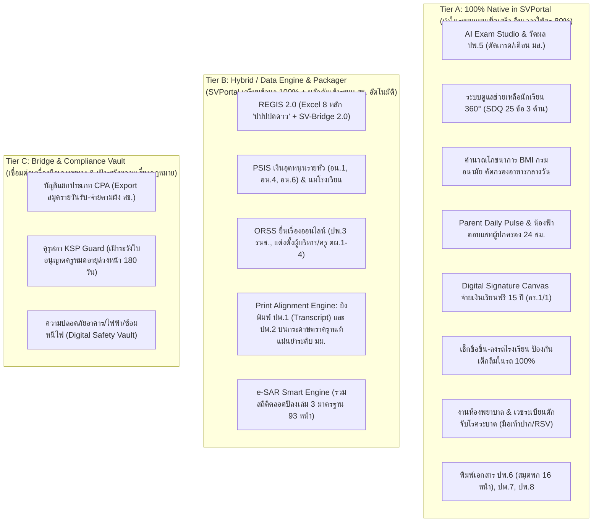
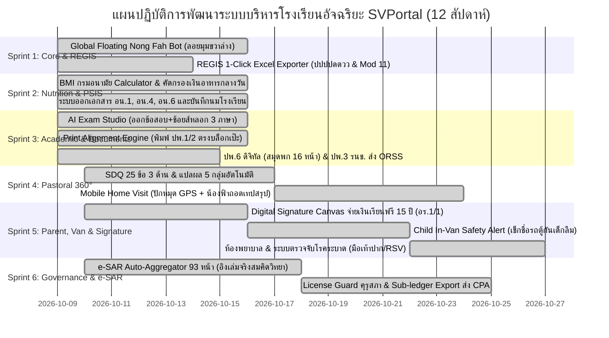

# แผนปฏิบัติการการพัฒนาระบบบริหารโรงเรียนอัจฉริยะครบวงจร (ฉบับสมบูรณ์ที่สุด)
## (Ultra-Detailed Master Implementation Plan: SVPortal & Nong Fah Super-Agent)
**โรงเรียนสมคิดวิทยา (Somkidvittaya School — รหัสสถานศึกษา: 1121100013)**
**กรอบกฎหมายอ้างอิง:** พ.ร.บ. โรงเรียนเอกชน พ.ศ. 2550 (และฉบับที่ 2 พ.ศ. 2554), ระเบียบ ศธ., คุรุสภา, สตง., และคู่มือ สช. 52 เล่ม

---

## 1. บทสรุปผู้บริหารและหลักการไตร่ตรองเชิงสถาปัตยกรรม (Executive Summary & Architecture)

จากการสืบค้น วิเคราะห์กฎหมาย และไตร่ตรองความเหมาะสมของทุกภาระงานของโรงเรียนเอกชนในระบบ เราได้จัดแบ่งงานทั้งหมดออกเป็น **3 ระดับสถาปัตยกรรม (The 3-Tier Classification)** เพื่อให้ **SVPortal** เป็นศูนย์กลางระบบงานและฐานข้อมูลอัจฉริยะที่แท้จริง โดย **"ไม่ฝืนทำในสิ่งที่ไม่ควรทำ แต่ทำสิ่งที่ต้องทำให้อัจฉริยะและง่ายที่สุดสำหรับครูและเจ้าหน้าที่"**:



---

## 2. วิธีการทำให้น้องฟ้าและ SVPortal ช่วยงานครูและเจ้าหน้าที่ให้ง่ายที่สุด (Radical Ergonomics)

| ภาระงานโรงเรียนเอกชน | ปัญหาและความยากเดิมที่ครู/เจ้าหน้าที่ต้องเจอ | วิธีที่ SVPortal & น้องฟ้า ทำให้ง่ายที่สุด (10x Easier) |
|---|---|---|
| **การออกข้อสอบ & ตัดเกรด ปพ.5** | ครูเสียเวลาหลายสัปดาห์ในการคิดช้อยส์หลอก ตัดเกรดมือ และเสี่ยงคิดคะแนนผิด | • ครูพิมพ์หัวข้อเรื่อง -> น้องฟ้าสร้างข้อสอบพร้อม **ช้อยส์หลอก 4 ตัวเลือก + เฉลย 3 ภาษา** ทันที<br>• นำเข้าคะแนน -> ระบบตัดเกรด 8 ระดับอัตโนมัติ<br>• ดักจับเวลาเรียนแตะ 80% แจ้งเตือนครูก่อนเด็กติด มส. |
| **การแจกเงินเรียนฟรี 15 ปี (แบบ อร.1/1)** | ใบเซ็นชื่อกระดาษสูญหาย ผู้ปกครองไม่ยอมมาเซ็น โดน สตง. เรียกเงินคืน | • **Digital Signature Canvas บนแท็บเล็ต/มือถือ**: ผู้ปกครองเซ็นชื่อบนหน้าจอครูได้ทันที<br>• ระบบนำลายเซ็นไปฝังลงใน **แบบ อร.1/1 อัตโนมัติ** เก็บเข้าคลาวด์ ปลอดภัย 100% |
| **การส่งข้อมูล สช. REGIS** | ไฟล์ Excel ถูกระบบ สช. ตีกลับซ้ำซาก เพราะฟอร์แมตวันที่ผิด หรือเลข 13 หลักไม่ผ่าน | • **1-Click OPEC REGIS Generator**: แปลงวันเกิดเป็นตัวเลขพุทธศักราช 8 หลัก **`ปปปปดดวว`** (เช่น `25651017`) ไม่มีขีดหรือทับ<br>• ตรวจสอบ Modulo 11 ก่อนส่งออก 100% |
| **การพิมพ์ ปพ.1 (Transcript) และ ปพ.2** | กระดาษมีตราครุฑดุนนูนและเลขคุมราคาแพง หากพิมพ์เบี้ยวตกขอบจะเสียกระดาษควบคุม | • **Print Alignment Engine (แม่นยำระดับมิลลิเมตร)**: ครูนำกระดาษ ปพ.1 ของจริงใส่เครื่องพิมพ์ ระบบจะยิงข้อความลงช่องว่างได้ตรงตำแหน่งเป๊ะ 100% |
| **การคัดกรองเงินอาหารกลางวัน** | ครูต้องนั่งคำนวณ BMI และเปิดกราฟเทียบทีละคน เสียเวลาและอาจตกหล่น | • ระบบนำส่วนสูง-น้ำหนักมาคำนวณเทียบ **กราฟมาตรฐานกรมอนามัยอัตโนมัติ**<br>• ตรวจสอบรายได้ครอบครัว < 40,000 บ./ปี ติดแท็กเด็กรับสิทธิ์และสรุปยอดส่ง PSIS ทันที |
| **การคัดกรอง SDQ และการเยี่ยมบ้าน** | ครูต้องตรวจข้อสอบ SDQ 25 ข้อ x 3 ชุด และนั่งพิมพ์รายงานเยี่ยมบ้านพร้อมแปะรูป | • ผู้ปกครอง/เด็ก ทำแบบประเมินผ่านมือถือ ระบบรวมคะแนน 5 ด้านอัตโนมัติ<br>• ครูเยี่ยมบ้านกดบันทึกในมือถือ ดึงพิกัด GPS อัตโนมัติ ถ่ายรูป น้องฟ้าถอดเทปสรุปรายงานทางการทันที |
| **ความปลอดภัยรถรับ-ส่งนักเรียน** | กังวลเรื่องเด็กลืมติดในรถตู้โรงเรียน ซึ่งเป็นข่าวร้ายแรงทุกปี | • **Child In-Van Safety Alert**: ครูเวรแตะชื่อเด็กขึ้น-ลงรถบนมือถือ<br>• หากถึงโรงเรียนแล้วยังมีเด็กค้างในรถ ระบบจะส่งเสียงไซเรนเตือนบนมือถือครูทันที |
| **ใบอนุญาตประกอบวิชาชีพครู (คุรุสภา)** | หากครูปล่อยใบอนุญาตหมดอายุ สช. จะตัดเงินอุดหนุนเงินเดือนครูทันที | • **Teacher License Guard**: น้องฟ้าแจ้งเตือนล่วงหน้า 180 วัน, 90 วัน, 30 วัน พร้อมสรุปชั่วโมง CPD ให้ครูนำไปยื่นต่ออายุใน KSP e-Service ได้ทันที |
| **รายงานประเมินตนเอง e-SAR 93 หน้า** | สิ้นปีการศึกษาต้องตั้งคณะทำงานวิ่งขอข้อมูลจากทุกฝ่ายมาพิมพ์เล่ม หนาเกือบ 100 หน้า | • **e-SAR Auto-Aggregator**: น้องฟ้ารวบรวมสถิตินักเรียน ผลการเรียน 8 สาระ และโภชนาการทั้งปี สรุปใส่เล่มรายงาน e-SAR 93 หน้าตามเล่มจริงสมคิดวิทยาให้อัตโนมัติ 100% |

---

## 3. แผนการดำเนินงาน 6 ระยะอย่างละเอียด (Comprehensive 6-Sprint Roadmap)



---

## 4. รายละเอียดงานในแต่ละสปรินต์ (Sprint Work Breakdown Structure)

### 🏃 Sprint 1: OPEC REGIS 1-Click Exporter & Foundation (สัปดาห์ที่ 1 - 2)
- **เป้าหมาย:** โรงเรียนสามารถดึงข้อมูลนักเรียนจาก SVPortal ออกเป็นไฟล์ `.xlsx` ที่นำเข้า `regis2.opec.go.th` ได้สำเร็จ 100% โดยไม่ถูกตีกลับ
- **งานที่ต้องทำ:**
  1. สร้าง Service `/lib/opec/regis-exporter.ts` และ API Endpoint `/api/opec/export-regis-excel`
  2. แปลงฟอร์แมตวันเกิดเป็นพุทธศักราช 8 หลักติดกัน **`ปปปปดดวว`** (เช่น `25651017`)
  3. แยกชีตอัตโนมัติ: Tab 1 = `ข้อมูลนักเรียนไทย`, Tab 2 = `ข้อมูลนักเรียนต่างชาติ (G-Code)`
  4. ทำระบบ Modulo 11 Validator ตรวจสอบเลขประจำตัวประชาชน 13 หลัก
  5. วางปุ่ม "ส่งออก สช. REGIS" บนหน้าจอทะเบียนนักเรียน (`/admin/students`)

### 🏃 Sprint 2: Nutrition Engine & PSIS Subsidy Suite (สัปดาห์ที่ 3 - 4)
- **เป้าหมาย:** คัดกรองเด็กทุพโภชนาการและยากจนเพื่อรับเงินอุดหนุนอาหารกลางวัน และเตรียมชุดเอกสาร อน.1-6
- **งานที่ต้องทำ:**
  1. สร้าง Nutrition Calculator (`/src/lib/pastoral/nutrition.ts`) คำนวณ BMI เทียบกราฟมาตรฐานกรมอนามัย (น้ำหนักตามเกณฑ์ส่วนสูง, ส่วนสูงตามเกณฑ์อายุ, น้ำหนักตามเกณฑ์อายุ)
  2. สร้างระบบคัดกรองเด็กรับเงินอาหารกลางวัน (เกณฑ์ผอม หรือรายได้ครอบครัว < 40,000 บ./ปี)
  3. สร้างโมดูลสรุปยอด **แบบ อน.1** (ยอด ณ 10 มิ.ย.), **แบบ อน.4** (รายเดือนเข้า-ออก), และ **แบบ อน.6**
  4. สร้างระบบบันทึกการแจกนมโรงเรียน (Daily Milk Log) รายวัน

### 🏃 Sprint 3: AI Exam Studio & Controlled Documents Hub (ปพ.1, ปพ.2, ปพ.3, ปพ.6) (สัปดาห์ที่ 5 - 6)
- **เป้าหมาย:** ลดภาระการออกข้อสอบ และมีระบบจัดพิมพ์เอกสาร ปพ. ควบคุมที่ได้มาตรฐาน ศธ. 100%
- **งานที่ต้องทำ:**
  1. เปิดหน้าจอ AI Exam Studio เชื่อมต่อกับ `generateChoicesWithNongFah` สร้างข้อสอบปรนัยพร้อมช้อยส์หลอก 4 ตัวเลือกและเฉลย 3 ภาษา
  2. พัฒนา **Print Alignment Engine** สำหรับพิมพ์คะแนนและข้อมูลลงบนแบบพิมพ์ ปพ.1 (Transcript สองหน้า) และ ปพ.2 ตัวจริงได้อย่างแม่นยำระดับมิลลิเมตร
  3. พัฒนาระบบจัดชุด **ปพ.3 (รน.ช.)** ดึงรายชื่อ ป.6 จบการศึกษา ส่งออกเป็นไฟล์พร้อมยื่นในระบบ ORSS
  4. พัฒนาระบบออก **ปพ.6 ดิจิทัล (สมุดพก 16 หน้า)** ให้ผู้ปกครองดูบนมือถือและสั่งพิมพ์เล่มพับได้ทันที

### 🏃 Sprint 4: Student Pastoral Care 360° (SDQ & Home Visit) (สัปดาห์ที่ 7 - 8)
- **เป้าหมาย:** ครูมีเครื่องมือดูแลช่วยเหลือนักเรียนครบวงจร 5 ขั้นตอนโดยไม่ต้องทำงานเอกสารซ้ำซ้อน
- **งานที่ต้องทำ:**
  1. สร้างระบบทำแบบประเมิน **SDQ 25 ข้อ 3 ด้าน** (ครู, ผู้ปกครอง, นักเรียน) พร้อมประมวลผลคะแนน 5 กลุ่มอัตโนมัติ
  2. สร้างระบบ **Mobile Home Visit**: ครูเปิดมือถือบันทึกการเยี่ยมบ้าน ดึงพิกัด GPS อัตโนมัติ ถ่ายรูป น้องฟ้าถอดเทปสรุปรายงานทางการแนบแผนที่ส่งฝ่ายกิจการนักเรียน
  3. สร้างหน้าจอ **Student 360° Profile** รวมสุขภาพ, โภชนาการ, SDQ, ผลการเรียน และสภาพครอบครัวไว้ในหน้าเดียว

### 🏃 Sprint 5: Digital Signature เรียนฟรี 15 ปี, ความปลอดภัยรถตู้ & ห้องพยาบาล (สัปดาห์ที่ 9 - 10)
- **เป้าหมาย:** ปิดความเสี่ยง สตง. ตรวจสอบเงินเรียนฟรี และป้องกันอุบัติเหตุในโรงเรียน 100%
- **งานที่ต้องทำ:**
  1. สร้าง **Digital Signature Canvas** ให้ผู้ปกครองลงลายมือชื่อรับเงินค่าอุปกรณ์/เครื่องแบบ (เรียนฟรี 15 ปี) บนแท็บเล็ต/มือถือ ออกเป็นเอกสาร **แบบ อร.1/1** แนบลายเซ็นจริงทันที
  2. พัฒนาระบบ **Child In-Van Safety Alert**: เช็กชื่อขึ้น-ลงรถโรงเรียน แจ้งเตือนผู้ปกครอง และส่งเสียงไซเรนหากมีเด็กลืมติดอยู่ในรถ
  3. พัฒนาระบบ **School Infirmary Hub**: บันทึกการจ่ายยา ประวัติแพ้ยา และระบบตรวจจับโรคระบาด (มือเท้าปาก/RSV) แจ้งเตือนสายชั้น

### 🏃 Sprint 6: e-SAR Smart Engine & Governance Hub (สัปดาห์ที่ 11 - 12)
- **เป้าหมาย:** ออกเล่มประเมินตนเอง e-SAR 93 หน้าอัตโนมัติ และเฝ้าระวังความเสี่ยงทางกฎหมาย สช.
- **งานที่ต้องทำ:**
  1. พัฒนา **e-SAR Auto-Aggregator 93 หน้า**: รวบรวมสถิติตลอดทั้งปีการศึกษาใส่ลงในตารางตามโครงสร้างเล่มจริงของโรงเรียนสมคิดวิทยา (`1121100013_sar_2568_complete.pdf`)
  2. พัฒนา **Teacher License Guard**: บันทึกเลขและวันหมดอายุใบอนุญาตประกอบวิชาชีพครู ให้น้องฟ้าแจ้งเตือนล่วงหน้า 180 วัน
  3. พัฒนา **Sub-ledger & Revenue Export**: สรุปยอดรายรับค่าเทอมและเงินอุดหนุนเป็นสมุดรายวันรับ-จ่ายตามผังบัญชี สช. สำหรับส่งผู้สอบบัญชีรับอนุญาต (CPA)
  4. พัฒนาระบบจัดเก็บรายงานการประชุมคณะกรรมการบริหารโรงเรียน (ม.30) และเอนจินคำนวณต้นทุนต่อหน่วย (Cost per Student) ตาม ม.32

---

## 5. ตารางสรุปฐานข้อมูลและ API Endpoint ที่ต้องสร้างใหม่ (Technical Specs)

```
┌───────────────────────────────────┬────────────────────────────────────────────────┐
│ ตารางฐานข้อมูลใหม่ (Supabase DB)  │ หน้าที่และข้อมูลที่จัดเก็บ                      │
├───────────────────────────────────┼────────────────────────────────────────────────┤
│ student_nutrition_records         │ ส่วนสูง, น้ำหนัก, BMI, เกณฑ์กรมอนามัย, สิทธิ์อาหาร│
│ student_sdq_assessments           │ คะแนน SDQ 25 ข้อ 5 ด้าน (ครู/ผปค./นร.)         │
│ student_home_visits               │ พิกัด GPS, ภาพถ่ายสภาพบ้าน, สรุปบันทึกเสียง      │
│ subsidy_free15y_disbursements     │ ยอดเงิน 4 หมวด, วันที่จ่าย, ภาพลายเซ็นดิจิทัล ผปค.│
│ school_van_routes_logs            │ ทะเบียนรถตู้, คนขับ, รายชื่อ นร., สถานะขึ้น-ลงรถ│
│ school_infirmary_visits           │ อาการป่วย, การจ่ายยา, บันทึกแพ้ยา, ชนิดโรคติดต่อ│
│ teacher_licenses_registry         │ เลขที่ใบอนุญาตคุรุสภา, วันหมดอายุ, แจ้งเตือน     │
│ school_board_meetings             │ วันที่ประชุม ม.30, วาระ, มติบอร์ด, เอกสารแนบ   │
└───────────────────────────────────┴────────────────────────────────────────────────┘
```

---

## 6. ตัวชี้วัดความสำเร็จในการดำเนินงาน (Key Success Metrics)

1. **ภาระงานเอกสารของครูลดลง 80%:** ครูไม่ต้องคำนวณ BMI เอง, ไม่ต้องตรวจ SDQ มือ, ไม่ต้องคีย์เกรดซ้ำ, และไม่ต้องพิมพ์รายงานเยี่ยมบ้านด้วยกระดาษ
2. **อัตราความผิดพลาดในการส่งข้อมูล สช. เป็น 0% (Zero Reject):** ข้อมูลที่ส่งออก REGIS, PSIS, ORSS และ e-SAR ผ่านการตรวจสอบกฎเกณฑ์ 100%
3. **การรับเงินอุดหนุนและสิทธิ์เรียนฟรี 15 ปี ครบถ้วน 100%:** ไม่มีเอกสารตกหล่น และมีหลักฐานลายเซ็นดิจิทัลพร้อมรับการตรวจจาก สตง.
4. **ความปลอดภัยนักเรียนสูงสุด:** สถิติเด็กลืมติดในรถรับ-ส่งเป็น 0 และดักจับโรคระบาดในโรงเรียนได้ตั้งแต่ระยะเริ่มต้น
