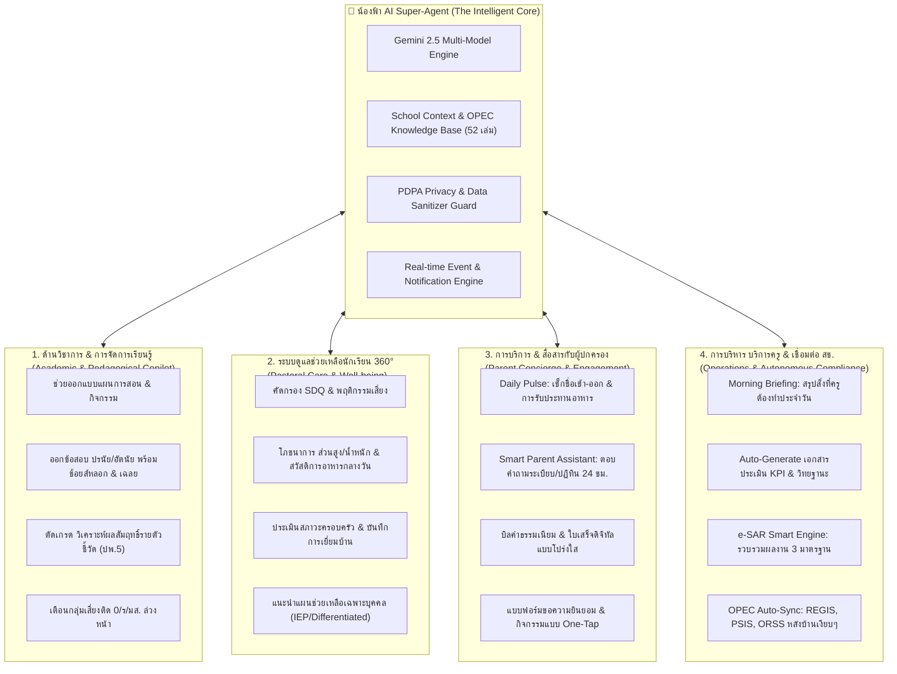

# วิสัยทัศน์และสถาปัตยกรรม "น้องฟ้า AI Super-Agent"
## สมองและหัวใจอัจฉริยะของ SVPortal (The All-in-One Smart School Copilot)
**โรงเรียนสมคิดวิทยา (Somkidvittaya School)**

---

## 1. ปรัชญาและแก่นแท้ของระบบ (Core Philosophy)

> **"ลดภาระงานเอกสาร คืนเวลาให้ครูได้ดูแลเด็กอย่างเต็มที่ สร้างความอุ่นใจให้ผู้ปกครอง และขับเคลื่อนโรงเรียนด้วยปัญญาประดิษฐ์ที่เข้าใจบริบทการศึกษาไทยอย่างแท้จริง"**

การพัฒนาระบบ **SVPortal** ไม่ได้ถูกสร้างขึ้นมาเพื่อให้เป็นเพียงแค่ซอฟต์แวร์จัดเก็บฐานข้อมูล (Database CRUD) หรือโปรแกรมส่งข้อมูลให้ สช. (OPEC Exporter) เท่านั้น แต่มีเป้าหมายสูงสุดคือการเป็น **"ระบบบริหารจัดการโรงเรียนที่ชาญฉลาดและครบวงจรที่สุด"** 

โดยมี **"น้องฟ้า" (Nong Fah)** ทำหน้าที่เป็น **AI Copilot ประจำตัวของทุกคนในระบบนิเวศโรงเรียน**:
- **สำหรับครู:** เป็นเพื่อนคู่คิด ผู้ช่วยสอน ผู้ช่วยงานธุรการ และผู้ช่วยวิเคราะห์เด็ก
- **สำหรับผู้บริหาร:** เป็นเสนาธิการฝ่ายยุทธศาสตร์ รายงานสถิติ แนวโน้ม และความเสี่ยงล่วงหน้า
- **สำหรับผู้ปกครอง:** เป็นศูนย์บริการข้อมูลลูกหลานที่อบอุ่น รวดเร็ว โปร่งใส ตลอด 24 ชั่วโมง
- **สำหรับนักเรียน:** เป็นผู้ดูแลความปลอดภัย โภชนาการ และการส่งเสริมศักยภาพเฉพาะบุคคล (Personalized Growth)

---

## 2. พิมพ์เขียว 4 เสาหลักของ "น้องฟ้า AI" (The 4 Pillars of Intelligence)



---

## 3. เจาะลึกการทำงานในแต่ละมิติ (Deep-Dive Capabilities)

### 🎓 มิติที่ 1: งานวิชาการและการจัดการเรียนการสอน (Academic Excellence)
> *เปลี่ยนครูจาก "คนทำงานเอกสารแผนการสอน" มาเป็น "ผู้อำนวยการการเรียนรู้ (Learning Facilitator)"*

1. **AI Exam Studio & Item Banking (มีอยู่แล้วและขยายต่อ)**:
   - ครูพิมพ์หัวข้อเรื่อง น้องฟ้าสร้างข้อสอบมาตรฐานตามหลักสูตรแกนกลาง พร้อม **ตัวเลือกหลอกที่มีหลักการทางวิชาการ (Plausible Distractors)** และคำอธิบายเฉลย 3 ภาษา (ไทย, อังกฤษ, จีน)
   - วิเคราะห์ค่าความยากง่าย (p) และอำนาจจำแนก (r) อัตโนมัติหลังนักเรียนทำข้อสอบ
2. **Intelligent Gradebook (ปพ.5 อัจฉริยะ)**:
   - ตรวจจับความผิดปกติของคะแนน (เช่น ข้อใดที่เด็กทั้งห้องตก น้องฟ้าจะแจ้งเตือนว่า *"เนื้อหาบทที่ 3 เรื่องเศษส่วน นักเรียน 70% ทำคะแนนได้ต่ำ แนะนำให้สอนซ่อมเสริมก่อนสอบปลายภาคค่ะ"*)
   - เฝ้าระวังอัตราเวลาเรียนต่ำกว่า 80% ก่อนที่จะสายเกินแก้ (Early Warning มส.)
3. **Personalized Learning Recommendation**:
   - แนะนำโจทย์เสริมทักษะสำหรับเด็กที่เรียนรู้เร็ว (Gifted) และแนะนำใบงานทบทวนพื้นฐานสำหรับเด็กที่ต้องการการดูแลเป็นพิเศษ

---

### 🛡️ มิติที่ 2: ระบบดูแลช่วยเหลือนักเรียนแบบองค์รวม (Student 360° Pastoral Care)
> *เข้าใจเด็กทุกคน ไม่ใช่แค่ตัวเลขผลการเรียน แต่คือสุขภาพ จิตใจ และครอบครัว*

1. **Holistic Student Profile (โปรไฟล์เด็ก 360 องศา)**:
   - รวมข้อมูล: สุขภาพ (น้ำหนัก, ส่วนสูง, BMI, โรคประจำตัว, ประวัติแพ้อาหาร), ความประพฤติ, คะแนน SDQ 5 ด้าน, การมาเรียน, สภาพความเป็นอยู่ของครอบครัว
2. **Smart Screening (ระบบคัดกรองอัตโนมัติ)**:
   - **ด้านสุขภาพ/โภชนาการ:** คำนวณเทียบเกณฑ์กรมอนามัยอัตโนมัติ พร้อมตรวจว่าเข้าข่ายรับเงินอุดหนุนอาหารกลางวันหรือไม่
   - **ด้านจิตวิทยาและพฤติกรรม:** วิเคราะห์ผลแบบประเมิน SDQ และแบบบันทึกพฤติกรรม หากพบสัญญาณเสี่ยง (เช่น อารมณ์ซึมเศร้า หรือพฤติกรรมก้าวร้าว) น้องฟ้าจะสะกิดครูประจำชั้นอย่างเป็นส่วนตัว พร้อมให้คำแนะนำเทคนิคการรับฟังเชิงบวก (Active Listening)
3. **Home Visit Assistant (ผู้ช่วยเยี่ยมบ้าน)**:
   - เตรียมประเด็นคำถามก่อนไปเยี่ยมบ้าน และสรุปบันทึกการเยี่ยมบ้านเป็นรายงานทางการทันทีที่ครูพิมพ์หรืออัดเสียงสรุปสั้นๆ

---

### 👨‍👩‍👧 มิติที่ 3: งานบริการและการสื่อสารกับผู้ปกครอง (Parent Concierge)
> *เปลี่ยนความกังวลของผู้ปกครอง ให้กลายเป็นความเชื่อมั่นและผูกพันกับโรงเรียน*

1. **Daily Parent Pulse (รายงานสั้นรายวัน)**:
   - ผู้ปกครองทราบทันทีเมื่อลูกแตะบัตรเข้าโรงเรียน, ได้รับประทานอาหารกลางวัน, และแตะบัตรกลับบ้าน
   - รายงานสรุปพฤติกรรมเชิงบวกประจำสัปดาห์ เช่น *"สัปดาห์นี้น้อง... ช่วยเหลือเพื่อนในห้องเรียนดีมากค่ะ"*
2. **24/7 Smart Parent Concierge (น้องฟ้าตอบคำถามผู้ปกครอง)**:
   - ผู้ปกครองสามารถสอบถามข้อมูลผ่าน LINE OA หรือหน้า Portal เช่น:
     - *"วันนี้การบ้านน้องมีอะไรบ้าง?"*
     - *"ชุดนักเรียนวันพฤหัสบดีต้องใส่ชุดอะไร?"*
     - *"เงินเรียนฟรี 15 ปี เบิกจ่ายเมื่อไหร่และต้องใช้เอกสารอะไรบ้าง?"*
   - น้องฟ้าตอบอย่างสุภาพ อ้างอิงระเบียบโรงเรียน และตรวจสอบสิทธิ์เฉพาะของบุตรหลานตนเอง (PDPA Protected)
3. **Transparent Financials & One-Click Approval**:
   - แจ้งเตือนบิลค่าธรรมเนียมการศึกษา, ยอดเงินคงเหลือในกระเป๋าเงิน (Wallet) สหกรณ์, ออกใบเสร็จดิจิทัล (Digital Receipt)
   - ส่งแบบฟอร์มขออนุญาตพาเด็กไปทัศนศึกษาหรือฉีดวัคซีน ให้ผู้ปกครองกดอนุมัติและลงลายมือชื่อดิจิทัลได้ในคลิกเดียว

---

### 🏛️ มิติที่ 4: งานบริหารและภาระงาน สช. ที่ทำงานอยู่เบื้องหลัง (Invisible Operations)
> *งานระเบียบ สช. ที่เคยยุ่งยาก จะกลายเป็นเรื่องอัตโนมัติที่ครูไม่ต้องสัมผัสอีกต่อไป*

1. **Autonomous Compliance Pipeline**:
   - ข้อมูลนักเรียนที่อัปเดตใน SVPortal ข้อมูลผลการเรียน และข้อมูลอาหารกลางวัน จะถูกแปลงฟอร์แมตและส่งเข้า **REGIS, PSIS, ORSS** โดยอัตโนมัติ (ผ่าน 1-Click Engine และ SV-Bridge)
   - ครูไม่ต้องสลับหน้าจอไปนั่งคีย์ข้อมูลซ้ำในระบบราชการ
2. **Morning Briefing & Proactive Assistant**:
   - เมื่อครูเปิด SVPortal ในตอนเช้า น้องฟ้าจะทักทายพร้อมสรุป:
     - *"สวัสดีค่ะครู วันนี้มีนักเรียนลาป่วย 2 คน, มีเวรประจำจุดหน้าประตูตอน 07:30 น., และมีเล่ม ปพ.5 รอตรวจ 1 เล่มค่ะ"*
3. **Automated e-SAR & Evaluation Packaging**:
   - ถึงรอบประเมินประกันคุณภาพภายใน น้องฟ้ารวบรวมข้อมูลเชิงสถิติตลอดทั้งปีการศึกษา ออกมาเป็นเล่มร่าง **e-SAR 3 มาตรฐาน 93 หน้า** พร้อมกราฟเปรียบเทียบย้อนหลัง 3 ปีให้ผู้บริหารตรวจทานได้ทันที

---

## 4. สถาปัตยกรรมทางเทคนิคเพื่อขับเคลื่อนวิสัยทัศน์ (Technical Architecture)

```
┌────────────────────────────────────────────────────────────────────────┐
│                        SVPortal Presentation Layer                     │
│  [Teacher Desktop]   [Parent Mobile/LINE]   [Admin Dashboard]  [POS]   │
└──────────────────────────────────┬─────────────────────────────────────┘
                                   │
┌──────────────────────────────────▼─────────────────────────────────────┐
│                 "น้องฟ้า" Unified Intelligence Gateway                │
│  ┌───────────────────────┐ ┌───────────────────┐ ┌──────────────────┐  │
│  │ Natural Language (NLP)│ │ Proactive Trigger │ │ Context Engine   │  │
│  │ Gemini 2.5 Multi-turn │ │ (Cron & DB Hooks) │ │ (Role-Based RAG) │  │
│  └───────────────────────┘ └───────────────────┘ └──────────────────┘  │
│  ┌──────────────────────────────────────────────────────────────────┐  │
│  │ PDPA & Privacy Sanitizer (ปกป้องข้อมูลส่วนบุคคลของเด็กและผู้ปกครอง)  │  │
│  └──────────────────────────────────────────────────────────────────┘  │
└──────────────────────────────────┬─────────────────────────────────────┘
                                   │
┌──────────────────────────────────▼─────────────────────────────────────┐
│                       SVPortal Core Services                           │
│  ┌───────────────┐ ┌───────────────┐ ┌──────────────┐ ┌─────────────┐  │
│  │ Academic Hub  │ │ Pastoral Care │ │ Financial &  │ │ Forms &     │  │
│  │ (ปพ.1-5, สอบ) │ │ (SDQ, โภชนาการ)│ │ Free 15-Year │ │ Workflow    │  │
│  └───────┬───────┘ └───────┬───────┘ └──────┬───────┘ └──────┬──────┘  │
└──────────┼─────────────────┼────────────────┼────────────────┼─────────┘
           │                 │                │                │
┌──────────▼─────────────────▼────────────────▼────────────────▼─────────┐
│                    External Adapter & Compliance Layer                 │
│  ┌──────────────────────────────────────────────────────────────────┐  │
│  │ OPEC Sync Engine (REGIS Excel 8-digit, PSIS On.1-6, ORSS Fast)   │  │
│  └──────────────────────────────────────────────────────────────────┘  │
│  ┌──────────────────────────────────────────────────────────────────┐  │
│  │ SV-Bridge 2.0 Chrome Extension (Automated Web DOM Injection)     │  │
│  └──────────────────────────────────────────────────────────────────┘  │
└────────────────────────────────────────────────────────────────────────┘
```

---

## 5. การดำเนินการยกระดับสู่อนาคต (Execution Strategy)

1. **Immediate Step (ระยะสั้น - วันนี้):**
   - รวบรวมฟังก์ชันของน้องฟ้าที่มีอยู่แล้วในโค้ดเบส (`src/lib/notifications/nongfah-ai.ts`, `NongFahStudioModal`, `gemma.ts`) เข้าสู่ศูนย์กลาง **"Nong Fah Unified Service"**
   - พัฒนา **Global Chat & Command Bar (`Cmd+K` / Floating Avatar)** ให้ครูสามารถพูดคุย ขอคำแนะนำ และสั่งงานน้องฟ้าได้จากทุกหน้าจอ
2. **Intermediate Step (ระยะกลาง):**
   - เชื่อมต่อโมดูลดูแลช่วยเหลือนักเรียน (Student 360° Profile): รวมผลการเรียน สถิติเวลาเรียน และข้อมูลโภชนาการเข้าด้วยกัน เพื่อให้น้องฟ้าสามารถวิเคราะห์ความเชื่อมโยง (เช่น *พบว่าเด็กที่ขาดเรียนบ่อยมักมีน้ำหนักต่ำกว่าเกณฑ์และครอบครัวมีรายได้น้อย*)
   - เปิดฟังก์ชันให้ผู้ปกครองเข้าถึงข้อมูลลูกผ่านหน้า Portal / Chatbot
3. **Advanced Step (ระยะยาว):**
   - ทำให้น้องฟ้ากลายเป็น Autonomous Agent ที่ทำหน้าที่แบ็กเอนด์แบบเบ็ดเสร็จ: คัดกรองข้อมูล, สร้างไฟล์ส่ง สช. (REGIS, PSIS, ORSS), และจัดทำรูปเล่ม e-SAR ประจำปีให้อัตโนมัติ 100%
