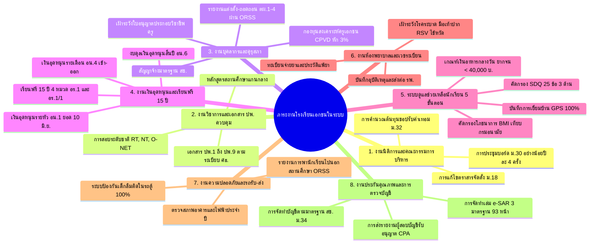

# รายงานการสืบค้นงานตามกฎหมายของโรงเรียนเอกชนในระบบ และการวิเคราะห์ส่วนขาดของ SVPortal
## (Comprehensive Statutory Audit & Feature Gap Analysis for Formal Private Schools)
**สำหรับ: โรงเรียนสมคิดวิทยา (รหัสสถานศึกษา: 1121100013)**
**กรอบกฎหมายอ้างอิง:** พระราชบัญญัติโรงเรียนเอกชน พ.ศ. 2550 (และฉบับที่ 2 พ.ศ. 2554), ระเบียบกระทรวงศึกษาธิการ, และระเบียบสำนักงานคณะกรรมการส่งเสริมการศึกษาเอกชน (สช.)

---

## 1. บทนำและกรอบกฎหมายที่กำกับดูแลโรงเรียนเอกชนในระบบ

การบริหาร "โรงเรียนเอกชนในระบบ" (Formal Private School) ในประเทศไทย มีภาระหน้าที่ตามกฎหมาย ข้อบังคับ และระเบียบปฏิบัติที่ซับซ้อนกว่าโรงเรียนรัฐบาล เนื่องจากต้องปฏิบัติตาม **พระราชบัญญัติโรงเรียนเอกชน พ.ศ. 2550** ควบคู่ไปกับ **มาตรฐานหลักสูตรและการวัดผลของกระทรวงศึกษาธิการ (ศธ.)**, **เกณฑ์มาตรฐานวิชาชีพครู (คุรุสภา)**, **การตรวจเงินแผ่นดิน (สตง.)**, และ **การประกันคุณภาพการศึกษา (สมศ.)**

เพื่อให้ **SVPortal** สามารถก้าวขึ้นเป็น **"ศูนย์กลางระบบงานและฐานข้อมูลอัจฉริยะที่สมบูรณ์แบบที่สุด (The Ultimate School OS)"** ระบบจะต้องไม่เป็นเพียงโปรแกรมบันทึกข้อมูลทั่วไป แต่ต้องครอบคลุม **ภารกิจภาคบังคับตามกฎหมาย (Statutory Duties)** และมี **"น้องฟ้า AI"** คอยกำกับการดำเนินงานไม่ให้ตกหล่นแม้แต่ข้อเดียว

---

## 2. โครงสร้าง 8 กลุ่มงานภาคบังคับตามกฎหมายของโรงเรียนเอกชนในระบบ

จากการสังเคราะห์ พ.ร.บ. โรงเรียนเอกชน, กฎกระทรวง, ประกาศ สช. และคู่มือระบบ 52 เล่ม พบว่าโรงเรียนเอกชนในระบบมีภาระงานสำคัญ 8 กลุ่มงาน ดังนี้:



---

## 3. ตารางวิเคราะห์เปรียบเทียบส่วนขาด (Detailed Gap Analysis Matrix)

ตารางนี้จำแนกสิ่งที่ **SVPortal มีอยู่แล้วในปัจจุบัน** เปรียบเทียบกับ **สิ่งที่โรงเรียนเอกชนต้องทำตามกฎหมาย** และระบุ **สิ่งที่ระบบเรายังขาดไป (Missing Gaps)** เพื่อความสมบูรณ์แบบ 100%:

| กลุ่มงานตามกฎหมาย | ภาระหน้าที่ภาคบังคับของโรงเรียนเอกชน | สถานะปัจจุบันใน SVPortal | สิ่งที่ระบบยังขาดไป (Missing Gaps) ที่ต้องพัฒนาเพิ่ม | ระดับความสำคัญ (Priority) |
|---|---|:---:|---|:---:|
| **1. งานเอกสารหลักฐานทางการศึกษา (ปพ.1 - ปพ.9)** | • **ปพ.1:** ระเบียนแสดงผลการเรียน (Transcript 2 หน้า) เก็บถาวร<br>• **ปพ.2:** ใบประกาศนียบัตร<br>• **ปพ.3:** แบบรายงานผู้สำเร็จการศึกษา (รน.ช.) ส่ง สช.<br>• **ปพ.5:** สมุดบันทึกผลการพัฒนาคุณภาพผู้เรียน<br>• **ปพ.6:** สมุดพกรายงานผู้ปกครอง (16 หน้า)<br>• **ปพ.7:** ใบรับรองผลการศึกษา<br>• **ปพ.8:** ระเบียนสะสมพัฒนาการ | ⚠️ **มีบางส่วน (Partial)**<br>(มีฐานข้อมูลคะแนนใน `academic_student_grades` และหน้าเล่ม ปพ.5) | ❌ ยังไม่มีตัว Export และพิมพ์ **ปพ.1 แบบมาตรฐานทางการสองหน้า**<br>❌ ยังไม่มีระบบจัดชุด **ปพ.3 (รน.ช.)** สเปก สช. เพื่อส่ง ORSS<br>❌ ยังไม่มีตัวสร้าง **ปพ.6 (สมุดพกทางการ)** สำหรับพิมพ์แจกผู้ปกครอง<br>❌ ยังไม่มีระบบออก **ปพ.7 (ใบรับรอง)** และ **ปพ.8 (ระเบียนสะสม)** อัตโนมัติ | 🔴 **สูงสุด (Critical)** |
| **2. งานเงินอุดหนุน สช. (PSIS Compliance)** | • **แบบ อน.1:** คำขอรับเงินอุดหนุนรายหัว ณ 10 มิ.ย.<br>• **แบบ อน.4:** รายงานนักเรียนเข้า-ออกประจำเดือน<br>• **แบบ อน.6:** รายงานยอดเงินอุดหนุนคงเหลือและดอกเบี้ย<br>• **อาหารกลางวัน:** คัดกรองเด็กทุพโภชนาการหรือรายได้ < 40,000 บาท/ปี<br>• **อาหารเสริมนม:** บันทึกการรับ-จ่ายนมโรงเรียน | ⚠️ **มีบางส่วน (Partial)**<br>(มีข้อมูลรายได้และส่วนสูงน้ำหนักใน `students_data.csv` แต่ยังไม่ได้ทำระบบคำนวณ) | ❌ ยังไม่มีระบบสร้างเอกสาร **อน.1, อน.4, อน.6** อัตโนมัติ<br>❌ ยังไม่มี **Nutrition Calculator** คำนวณ BMI กรมอนามัยเพื่อคัดกรองสิทธิ์อาหารกลางวันอัตโนมัติ<br>❌ ยังไม่มีระบบบันทึกและตรวจสอบจำนวนกล่อง **นมโรงเรียน (School Milk)** | 🔴 **สูงสุด (Critical)** |
| **3. โครงการเรียนฟรี 15 ปี (4 หมวด)** | • จัดสรรงบประมาณ 4 หมวด (หนังสือ, อุปกรณ์, เครื่องแบบ, กิจกรรม)<br>• **แบบ อร.1:** แผนการจัดซื้อ/จัดหา<br>• **แบบ อร.1/1:** หลักฐานการจ่ายเงินให้ผู้ปกครองพร้อมลายเซ็นจริง (สตง. ตรวจสอบเข้มงวด) | ❌ **ยังไม่มี (Missing)** | ❌ ยังไม่มีโมดูลแยกบัญชีงบประมาณเรียนฟรี 15 ปี 4 หมวด<br>❌ ยังไม่มีระบบพิมพ์เอกสาร **แบบ อร.1**<br>❌ ยังไม่มีระบบ **Digital Signature Canvas** ให้ผู้ปกครองเซ็นรับเงิน/สิ่งของผ่านแท็บเล็ตเพื่อออก **แบบ อร.1/1** ทันที | 🔴 **สูงสุด (Critical)** |
| **4. งานบริหารงานบุคคลและกองทุนสงเคราะห์ (CPVD)** | • **สัญญาจ้างครูมาตรฐาน สช.**<br>• **ใบอนุญาตประกอบวิชาชีพครู (คุรุสภา):** ต้องตรวจสอบวันหมดอายุ (ถ้าหมดอายุ สช. ตัดเงินอุดหนุนครูทันที!)<br>• **กองทุนสงเคราะห์ครูใหญ่และครู (CPVD):** หักเงินสะสม 3% และโรงเรียนสมทบ 3% ทุกเดือน<br>• **รายงานแต่งตั้ง-ถอดถอน (ตผ.1 - ตผ.4)** ผ่าน ORSS | ⚠️ **มีบางส่วน (Partial)**<br>(มีระบบตารางสอน ภาระงานสอน และ KPI แต่ยังขาดมิติด้านกฎหมาย สช.) | ❌ ยังไม่มีระบบ **เฝ้าระวังวันหมดอายุใบอนุญาตประกอบวิชาชีพครู** (แจ้งเตือนล่วงหน้า 6 เดือน)<br>❌ ยังไม่มีระบบคำนวณและออกรายงานหักเงิน **กองทุนสงเคราะห์ CPVD 3%**<br>❌ ยังไม่มีระบบจัดชุดเอกสาร **แต่งตั้ง/ถอดถอนบุคลากร (ตผ.1 - ตผ.4)** ส่ง ORSS | 🟠 **สูง (High)** |
| **5. งานนิติการและคณะกรรมการบริหารโรงเรียน** | • **การประชุมคณะกรรมการบริหารโรงเรียน (ม.30):** ต้องจัดประชุมอย่างน้อยปีละ 4 ครั้ง และมีบันทึกรายงานการประชุม<br>• **การกำหนดค่าธรรมเนียมการศึกษา (ม.32):** ต้องคำนวณต้นทุนต่อหน่วย (Cost per Student) เสนอบอร์ดและแจ้ง สช.<br>• **ตราสารจัดตั้งโรงเรียน:** จัดเก็บและควบคุมการแก้ไข | ❌ **ยังไม่มี (Missing)** | ❌ ยังไม่มีระบบจัดเก็บวาระและบันทึกรายงานการประชุมบอร์ดโรงเรียน<br>❌ ยังไม่มีโมดูล **คำนวณต้นทุนต่อหน่วย (Cost per Student Calculation Engine)** สำหรับยื่นขอปรับค่าธรรมเนียมการศึกษาตาม ม.32<br>❌ ยังไม่มีระบบติดตามและจัดเก็บเอกสารตราสารจัดตั้ง | 🟡 **ปานกลาง (Medium)** |
| **6. ระบบดูแลช่วยเหลือนักเรียน 5 ขั้นตอน (Pastoral Care)** | • **ขั้นที่ 1:** รู้จักนักเรียนรายบุคคล (ข้อมูลรอบด้าน)<br>• **ขั้นที่ 2:** การคัดกรอง (SDQ 25 ข้อ 3 ด้าน: ครู, ผู้ปกครอง, เด็ก)<br>• **ขั้นที่ 3:** การส่งเสริมและพัฒนา<br>• **ขั้นที่ 4:** การป้องกันและแก้ไขปัญหา<br>• **ขั้นที่ 5:** การส่งต่อ (ภายในและภายนอก)<br>• **การเยี่ยมบ้าน 100%:** บันทึกภาพ พิกัด GPS และสภาพความเป็นอยู่ | ⚠️ **มีบางส่วน (Partial)**<br>(มีข้อมูลนักเรียนพื้นฐานและระบบเช็กชื่อ) | ❌ ยังไม่มีระบบประเมินและประมวลผล **SDQ 25 ข้อ** พร้อมจำแนกกลุ่มปกติ/เสี่ยง/มีปัญหา<br>❌ ยังไม่มีระบบ **บันทึกการเยี่ยมบ้านดิจิทัล (Digital Home Visit)** พร้อมแนบภาพและพิกัดแผนที่<br>❌ ยังไม่มีบันทึกการให้คำปรึกษา (Counseling Log) และการส่งต่อ | 🟠 **สูง (High)** |
| **7. งานห้องพยาบาลและเวชระเบียนโรงเรียน** | • ทะเบียนประวัติสุขภาพและประวัติแพ้ยา/อาหาร<br>• บันทึกการรับบริการห้องพยาบาลและการจ่ายยา<br>• เฝ้าระวังโรคระบาดในเด็ก (มือเท้าปาก, RSV, ไข้หวัดใหญ่) เพื่อปิดห้องเรียนหรือสั่งทำความสะอาด<br>• บันทึกอุบัติเหตุในโรงเรียนและการส่งต่อ รพ. | ❌ **ยังไม่มี (Missing)** | ❌ ยังไม่มีระบบทะเบียนห้องพยาบาล (Infirmary Log)<br>❌ ยังไม่มีระบบบันทึกประวัติการแพ้ยาและโรคประจำตัวที่เตือนครูอัตโนมัติ<br>❌ ยังไม่มีระบบตรวจจับและแจ้งเตือน **สถิติโรคติดต่อในโรงเรียน** รายชั้นเรียน | 🟡 **ปานกลาง (Medium)** |
| **8. งานความปลอดภัยและรถรับ-ส่งนักเรียน** | • **ระบบควบคุมรถรับ-ส่งนักเรียน:** ป้องกันเด็กลืมติดในรถ 100% (กฎกระทรวงกำหนดเข้มงวด)<br>• บันทึกทะเบียนรถ ใบขับขี่สาธารณะของคนขับ และครูเวรประจำรถ<br>• การรายงานการพานักเรียนไปนอกสถานศึกษา (ทัศนศึกษา) ผ่าน ORSS | ❌ **ยังไม่มี (Missing)** | ❌ ยังไม่มีระบบ **เช็กชื่อขึ้น-ลงรถโรงเรียน (Child In-Van Safety)** แจ้งเตือนผู้ปกครองแบบเรียลไทม์<br>❌ ยังไม่มีทะเบียนสายรถตู้และประวัติคนขับรถ<br>❌ ยังไม่มีระบบจัดทำเอกสารและ Checklist แผนรักษาความปลอดภัยทัศนศึกษาเพื่อยื่น ORSS | 🟠 **สูง (High)** |
| **9. งานประกันคุณภาพ (e-SAR) และการตรวจบัญชี CPA** | • รายงานการประเมินตนเองของสถานศึกษา (e-SAR) 3 มาตรฐาน 93 หน้า<br>• ระบบบัญชีโรงเรียนเอกชนตามมาตรฐาน สช. (ม.34)<br>• การจัดส่งรายงานผู้สอบบัญชีรับอนุญาต (CPA) ภายใน 150 วันนับแต่วันสิ้นปี | ⚠️ **มีบางส่วน (Partial)**<br>(มีข้อมูลสถิติกระจัดกระจายในระบบ แต่ยังไม่ได้รวมเล่มอัตโนมัติ) | ❌ ยังไม่มี **e-SAR Auto-Aggregator** รวมตัวเลข 8 สาระ ผล O-NET/NT และสุขภาพลงเล่ม 93 หน้าอัตโนมัติ<br>❌ ยังไม่มีระบบเตรียมข้อมูลบัญชีรายรับ-รายจ่ายตามผังบัญชี สช. สำหรับส่งผู้สอบบัญชี (CPA) | 🟠 **สูง (High)** |

---

## 4. แผนภูมิบูรณาการฟังก์ชันใหม่สู่ SVPortal (New Architecture Overview)

เพื่อให้ SVPortal ครอบคลุมภารกิจทั้งหมด 100% เราจะเสริม **6 โมดูลใหม่** เข้าสู่ระบบ โดยมี **น้องฟ้า AI** เป็นผู้เชื่อมโยงข้อมูลทุกส่วน:

```
┌────────────────────────────────────────────────────────────────────────┐
│                        SVPortal Super-System                           │
├────────────────────────────────────────────────────────────────────────┤
│ [โมดูลที่มีอยู่เดิม]                                                   │
│  ├── Academic Hub (ตารางสอน, เล่ม ปพ.5 พื้นฐาน, ออกข้อสอบ)            │
│  ├── Student Registry (ฐานข้อมูลนักเรียน, ที่อยู่, ผู้ปกครอง)          │
│  ├── Attendance & Canteen POS (เช็กชื่อ, กระเป๋าเงิน, สหกรณ์)          │
│  ├── Forms Studio (สร้างแบบฟอร์ม, สำรวจ, ตรวจคำตอบ)                   │
│  └── Global Floating Nong Fah Bot (ลอยมุมขวาล่าง, Search Grounding)    │
├────────────────────────────────────────────────────────────────────────┤
│ [โมดูลใหม่ที่ต้องพัฒนาเพิ่มเพื่อปิด Gap ทั้งหมด] 🚀                     │
│  ├── 1. Ministry Controlled Doc Hub: ออก ปพ.1, ปพ.3 (รนช.), ปพ.6, ปพ.7  │
│  ├── 2. PSIS & Free 15Y Financial Suite: อน.1-6, อร.1/1 + ลายเซ็นดิจิทัล│
│  ├── 3. Student Pastoral Care 360°: SDQ 25 ข้อ, BMI กรมอนามัย, เยี่ยมบ้าน│
│  ├── 4. Private School HR & CPVD Guard: เตือนใบอนุญาตครู, หัก 3% กองทุน │
│  ├── 5. School Bus Safety & Infirmary: เช็กชื่อรถตู้, ทะเบียนห้องพยาบาล  │
│  └── 6. Legal & e-SAR Engine: บันทึกบอร์ด ม.30, ต้นทุน ม.32, เล่ม SAR 93 หน้า│
└────────────────────────────────────────────────────────────────────────┘
```

---

## 5. แผนปฏิบัติการเติมเต็มส่วนขาดอย่างเป็นรูปธรรม (Actionable Roadmap)

### 📌 ระยะสั้น: แก้ปัญหาเร่งด่วนและงานเสี่ยงโดนตัดเงินอุดหนุน (สัปดาห์ที่ 1 - 3)
1. **OPEC REGIS 1-Click Excel Exporter:**
   - แปลงข้อมูลนักเรียนที่มีอยู่เป็น `.xlsx` รูปแบบ 8 หลัก `ปปปปดดวว` (เสร็จทันที)
2. **ระบบเฝ้าระวังใบอนุญาตประกอบวิชาชีพครู (Teacher License Guard):**
   - บันทึกเลขและวันหมดอายุใบอนุญาตประกอบวิชาชีพของครูทุกคนในระบบ
   - ให้น้องฟ้าแจ้งเตือนล่วงหน้า 180 วัน, 90 วัน, 30 วัน ก่อนหมดอายุ ป้องกัน สช. ระงับเงินเดือนครู
3. **ระบบคัดกรองโภชนาการ BMI กรมอนามัย & สิทธิ์เงินอาหารกลางวัน:**
   - ดึงค่าน้ำหนัก ส่วนสูงจากฐานข้อมูลมาคำนวณเทียบกราฟมาตรฐานกรมอนามัย คัดกรองเด็กทุพโภชนาการและยากจน (< 40,000 บ./ปี) สรุปยอดขอรับเงินอุดหนุนอาหารกลางวันทันที

### 📌 ระยะกลาง: งานเอกสารควบคุม ปพ. และเงินเรียนฟรี 15 ปี (สัปดาห์ที่ 4 - 7)
1. **โมดูลเอกสาร ปพ. ควบคุม (ปพ.1, ปพ.3, ปพ.6):**
   - พัฒนาระบบ Generate **ปพ.1 (Transcript สองหน้า)** พิมพ์ได้มาตรฐาน ศธ.
   - พัฒนาระบบจัดชุด **ปพ.3 (รน.ช.)** ดึงรายชื่อ ป.6 จบการศึกษา พร้อมส่ง ORSS
   - พัฒนาระบบออก **ปพ.6 (สมุดพก 16 หน้า)** แจ้งผู้ปกครองสิ้นภาคเรียน
2. **ระบบบริหารโครงการเรียนฟรี 15 ปี (แบบ อร.1 และ อร.1/1):**
   - แยกบัญชีงบประมาณ 4 หมวด
   - สร้างหน้าจอลงลายมือชื่อดิจิทัล (Digital Signature Canvas) บนแท็บเล็ต/มือถือ สำหรับผู้ปกครองเซ็นรับเงินและสิ่งของ ออกเป็นเอกสาร อร.1/1 แนบลายเซ็นจริงทันที

### 📌 ระยะยาว: ระบบความปลอดภัย นิติการ และ e-SAR สมบูรณ์แบบ (สัปดาห์ที่ 8 - 12)
1. **ระบบความปลอดภัยรถรับ-ส่งนักเรียน (Child In-Van Safety):**
   - แอปเช็กชื่อเด็กขึ้น-ลงรถโรงเรียน พร้อมแจ้งเตือนผู้ปกครอง และระบบส่งเสียงเตือนหากมีเด็กค้างอยู่ในรถ
2. **งานห้องพยาบาลและเวชระเบียน (School Infirmary Hub):**
   - ทะเบียนจ่ายยา บันทึกอาการแพ้ และระบบดักจับสถิติโรคระบาดในเด็ก (มือเท้าปาก, RSV) แจ้งเตือนครูสายชั้น
3. **ระบบ e-SAR Auto-Aggregator 93 หน้า:**
   - น้องฟ้ารวบรวมสถิตินักเรียน ผลการเรียน 8 สาระ สถิติโภชนาการ และผล O-NET/NT สรุปใส่เล่มรายงาน e-SAR 3 มาตรฐาน 93 หน้า พร้อมพิมพ์ส่ง สช. และ สมศ.
4. **ระบบงานนิติการและคณะกรรมการบริหาร (ม.30 & ม.32):**
   - บันทึกการประชุมบอร์ดปีละ 4 ครั้ง และเอนจินคำนวณต้นทุนต่อหน่วย (Cost per Student) สำหรับขอปรับค่าธรรมเนียมการศึกษา
