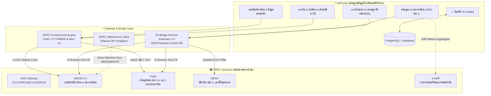

# แผนปฏิบัติการการบูรณาการระบบ SVPortal สู่ระบบ สช. แบบครบวงจร
## (Full-Stack Integration Implementation Plan: SVPortal ⟷ OPEC Ecosystem)
**โรงเรียนสมคิดวิทยา (รหัสสถานศึกษา: 1121100013)**

---

## 1. บทสรุปผู้บริหาร (Executive Summary)

จากการสืบค้น วิเคราะห์สถาปัตยกรรม และสังเคราะห์คู่มือระบบของสำนักงานคณะกรรมการส่งเสริมการศึกษาเอกชน (สช.) จำนวน 52 เล่ม รวมกว่า 2,500 หน้า และคลิปวิดีโอคู่มือการอบรมทุกชุด ครอบคลุม **5 เสาหลักระบบสารสนเทศ สช.** ได้แก่:
1. **SSO (sso.opec.go.th)**: ระบบลงทะเบียนและยืนยันตัวตนกลาง
2. **REGIS / REGIS 2 (regis.opec.go.th)**: ระบบทะเบียนนักเรียนและวัดผลหลักสูตรแกนกลาง
3. **PSIS (psis.opec.go.th)**: ระบบขอรับเงินอุดหนุนรายบุคคล อาหารกลางวัน และเรียนฟรี 15 ปี
4. **ORSS (orss.opec.go.th)**: ระบบยื่นเรื่องออนไลน์ (ปพ.3, แต่งตั้งผู้บริหาร/ครู, ขอเพิ่มค่าธรรมเนียม)
5. **e-SAR (esar.opec.go.th)**: ระบบประเมินตนเองของสถานศึกษาตามมาตรฐานประกันคุณภาพ

**เป้าหมายหลัก (Core Objectives):**
- **Zero Duplicate Entry**: ครูและธุรการกรอกข้อมูลใน SVPortal เพียงครั้งเดียว ข้อมูลไหลเข้า สช. โดยอัตโนมัติ
- **Zero Human Error & Reject**: ระบบตรวจจับกฎเกณฑ์ (Validation Engine) เช่น รหัส 13 หลัก, รูปแบบวันที่พุทธศักราช `ปปปปดดวว`, เกณฑ์ภาวะทุพโภชนาการ และรายได้ครัวเรือน ก่อนส่งออก
- **100% On-Time Compliance**: แจ้งเตือนและเตรียมเอกสารตามรอบปฏิทิน สช. (10 มิ.ย., ทุกสิ้นเดือน, รายไตรมาส, สิ้นปีการศึกษา)
- **AI-Powered น้องฟ้า Copilot**: ติดตั้งโมเดล AI ภายใน SVPortal ทำหน้าที่เป็นที่ปรึกษาระเบียบ สช. และผู้ช่วยกรอกข้อมูลอัจฉริยะ

---

## 2. แผนผังบูรณาการระบบ (System Architecture & Data Flow)

---

## 3. แผนการดำเนินงาน 5 ระยะ (5-Phase Implementation Roadmap)

| ระยะ (Phase) | รายละเอียดภารกิจ (Deliverables) | ระยะเวลา | ระบบ สช. ที่เกี่ยวข้อง | ผลลัพธ์ที่ได้ |
|---|---|:---:|:---:|:---:|
| **Phase 1** | **Quick-Win: OPEC 1-Click Excel Generator** สร้างระบบ Export ข้อมูลนักเรียน/ผลการเรียนตามสเปก สช. เป๊ะ 100% | สัปดาห์ 1 - 2 | REGIS, PSIS | นำไฟล์เข้า REGIS ได้ทันที ไม่โดนตีกลับ |
| **Phase 2** | **SV-Bridge Chrome Extension 2.0 (Supercharged)** อัปเกรด Extension รองรับการกรอกข้อมูลนักเรียน + อาหารกลางวัน | สัปดาห์ 3 - 4 | REGIS, PSIS, ORSS | กรอกข้อมูลบนเว็บ สช. อัตโนมัติในคลิกเดียว |
| **Phase 3** | **โมดูลการเงินและเงินอุดหนุน (PSIS Compliance Suite)** ระบบจัดการ อน.1-6, อร.1, อร.1/1 พร้อม Digital Signature | สัปดาห์ 5 - 6 | PSIS | ตรวจสอบยอดเงินอุดหนุน & ออกเอกสารเบิกจ่ายครบถ้วน |
| **Phase 4** | **ORSS Workflow & e-SAR Data Engine** เคลียร์ค้าง ปพ.3/รนช., จัดการเอกสารบุคลากร และคำนวณสถิติ e-SAR | สัปดาห์ 7 - 8 | ORSS, e-SAR | ส่ง ปพ.3 ทันกำหนด & ออกตาราง e-SAR อัตโนมัติ |
| **Phase 5** | **Direct WebService API & AI "น้องฟ้า" Copilot** เชื่อมต่อ API ตรง สช. + เปิดตัวน้องฟ้าตอบคำถามและทำงานแทนครู | สัปดาห์ 9 - 10 | ทั่วทั้งระบบ (All) | โรงเรียนไร้รอยต่อสู่ยุค AI Automation 100% |

---

## 4. รายละเอียดแต่ละระยะ (Deep-Dive Specifications)

### 📌 ระยะที่ 1: Quick-Win: OPEC 1-Click Excel Generator (สัปดาห์ที่ 1 - 2)
**โจทย์หลัก:** ครูและธุรการเสียเวลากับการจัดฟอร์แมต Excel ส่งเข้า REGIS แล้วระบบแจ้งเตือนว่า "รูปแบบวันที่ผิด" หรือ "รหัสบัตรประชาชนไม่ถูกต้อง"

**งานที่ต้องส่งมอบ (Deliverables):**
1. **OPEC Formatter Service (`/lib/opec/regis-exporter.ts`)**:
   - ดึงข้อมูลจากฐานข้อมูล SVPortal (`students_data`)
   - แยกชีตอัตโนมัติ: Tab 1 = `ข้อมูลนักเรียนไทย`, Tab 2 = `ข้อมูลนักเรียนต่างชาติ (G-Code)`
   - **กฎเหล็กเรื่องวันที่:** แปลง ค.ศ./พ.ศ. เป็นรูปแบบตัวเลข 8 หลักพุทธศักราชติดกัน `ปปปปดดวว` (เช่น `25651017`) **ห้ามมีเครื่องหมาย `/` หรือ `-` เด็ดขาด**
   - **ระบบคัดกรองเพศ:** ชาย = `1`, หญิง = `2`
   - **Modulo 11 Validator:** ตรวจสอบความถูกต้องของเลขบัตรประชาชน 13 หลักของนักเรียนและบิดามารดาก่อน Generate ไฟล์
2. **ปุ่ม "Export สช. REGIS" ในหน้าทะเบียนนักเรียน SVPortal**:
   - คลิกเดียวได้ไฟล์ `.xlsx` ที่ผ่านเกณฑ์ สช. 100% พร้อมอัปโหลดเข้าสู่ `regis2.opec.go.th`
3. **PSIS Nutrition & Lunch Calculator**:
   - ฟังก์ชันคำนวณเกณฑ์อาหารกลางวันอัตโนมัติ: ตรวจสอบความสูง/น้ำหนัก เทียบกราฟเกณฑ์กรมอนามัย (ทุพโภชนาการ) และรายได้ครอบครัว (< 40,000 บาท/ปี) ออกเป็นรายงานพร้อมส่ง PSIS

---

### 📌 ระยะที่ 2: SV-Bridge Chrome Extension 2.0 (สัปดาห์ที่ 3 - 4)
**โจทย์หลัก:** หน้าเว็บ สช. บางส่วนไม่มีฟังก์ชันรับ Excel แต่ต้องกรอกทีละคน หรือต้องตรวจเช็กหน้างาน

**งานที่ต้องส่งมอบ (Deliverables):**
1. **ขยายขีดความสามารถของ `chrome-extension/sv-bridge`**:
   - เดิม: รองรับการกรอกคะแนน (Grade Injection) ใน REGIS
   - ใหม่ 2.0:
     - **REGIS Profile Filler**: เมื่อเปิดหน้าแก้ไขข้อมูลนักเรียนใน REGIS Extension จะดึงข้อมูลนักเรียนจาก SVPortal มากดเติมทุกช่อง (ชื่อ, นามสกุล, ศาสนา, ที่อยู่, ข้อมูลพ่อแม่) และกดบันทึกให้อัตโนมัติ
     - **PSIS Daily Lunch / Attendance Injector**: ดึงสถานะการเช็กชื่อและการรับประทานอาหารกลางวันจาก SVPortal ไปกรอกในระบบ PSIS แบบ Bulk
     - **ORSS Helper**: เมื่อเปิดหน้ายื่นคำขอใน ORSS ช่วยกรอกข้อมูลผู้ยื่น (นายพีรวัฒน์ สันติวรากร), ข้อมูลโรงเรียน และตรวจสอบเอกสารแนบตาม Checklist
2. **Security & Session Guard**:
   - ระบบแจ้งเตือน Session Timeout ก่อนหน้าเว็บ สช. จะตัด (ป้องกันกรณีครูกรอกข้อมูลค้างไว้แล้วข้อมูลหลุด)

---

### 📌 ระยะที่ 3: โมดูลเงินอุดหนุนและการเงิน (PSIS Suite) (สัปดาห์ที่ 5 - 6)
**โจทย์หลัก:** เงินอุดหนุนรายบุคคลและโครงการเรียนฟรี 15 ปีเป็นเรื่องที่มีการตรวจสอบบัญชีเข้มงวดที่สุด (สตง. / สช.)

**งานที่ต้องส่งมอบ (Deliverables):**
1. **ระบบจัดทำเอกสาร อน.1 - อน.6**:
   - **แบบ อน.1**: คำขอรับเงินอุดหนุนต้นปีการศึกษา (ณ 10 มิ.ย.) รวบรวมรายชื่อนักเรียนที่มีตัวตนจริง แยกชั้นเรียน
   - **แบบ อน.4**: คำขอรับเงินอุดหนุนประจำเดือน ตรวจสอบรายชื่อเข้า-ออกย้ายสถานศึกษาในเดือนนั้นๆ
   - **แบบ อน.6**: รายงานยอดเงินอุดหนุนคงเหลือและดอกเบี้ยสะสมประจำปี
2. **ระบบบริหารโครงการเรียนฟรี 15 ปี (แบบ อร.1 และ อร.1/1)**:
   - บัญชีแยกรายการ 4 หมวด: หนังสือเรียน, อุปกรณ์การเรียน, เครื่องแบบนักเรียน, กิจกรรมพัฒนาคุณภาพผู้เรียน
   - **Digital Receipt & Signature Module**: ผู้ปกครองสามารถลงลายมือชื่อรับเงิน/สิ่งของผ่านหน้าจอแท็บเล็ตหรือมือถือใน SVPortal โดยระบบจะ Generate ออกมาเป็นเอกสาร **แบบ อร.1/1** แนบลายเซ็นจริงพร้อมตรวจนับได้ทันที

---

### 📌 ระยะที่ 4: ORSS Workflow & e-SAR Engine (สัปดาห์ที่ 7 - 8)
**โจทย์หลัก:** ปัจจุบันโรงเรียนมีงานค้างใน ORSS (ส่ง ปพ.3 และแต่งตั้งผู้จัดการ) และต้องเตรียมทำ e-SAR ประจำปี

**งานที่ต้องส่งมอบ (Deliverables):**
1. **ORSS Fast-Track Packager**:
   - **โมดูลจัดชุด ปพ.3 (รน.ช.)**: ดึงข้อมูลผู้จบการศึกษา ป.6 จากระบบวัดผล SVPortal ตรวจสอบหน่วยกิตและ GPAX จัดฟอร์แมตตามคู่มือ `manual_orss` พร้อมให้ ผู้อำนวยการ ลงนามดิจิทัลส่ง สช. ทันที
   - **โมดูลเตรียมเอกสารแต่งตั้ง/ถอดถอนผู้บริหาร (ตผ.1 - ตผ.4)**: ฟอร์มสร้างเอกสารสัญญาจ้าง, สำเนาใบอนุญาตประกอบวิชาชีพ, มติที่ประชุมคณะกรรมการบริหาร รวบเป็น PDF Package พร้อมอัปโหลดขึ้น ORSS
2. **e-SAR Smart Aggregator**:
   - ดึงข้อมูลจาก SVPortal สรุปสถิติลงในโครงสร้าง 93 หน้าตามเล่ม `1121100013_sar_2568_complete.pdf`:
     - จำนวนนักเรียน ชาย-หญิง ทุกระดับชั้น (อ.1 - ป.6)
     - สถิติผลสัมฤทธิ์ทางการเรียน 8 กลุ่มสาระ
     - ร้อยละผลการประเมินคุณลักษณะอันพึงประสงค์ และการอ่านคิดวิเคราะห์
     - สถิตินักเรียนที่มีน้ำหนัก-ส่วนสูงตามเกณฑ์มาตรฐาน

---

### 📌 ระยะที่ 5: Official WebService API & AI "น้องฟ้า" Copilot (สัปดาห์ที่ 9 - 10+)
**โจทย์หลัก:** ลดการพึ่งพา Extension และ Browser สู่การเชื่อมต่อระดับ Machine-to-Machine พร้อมมี AI เป็นผู้ช่วยส่วนตัว

**งานที่ต้องส่งมอบ (Deliverables):**
1. **Official OPEC WebService Integration (ตามคู่มือ Manual 39)**:
   - ประสานงานขอสิทธิ์ API Key และ Whitelist IP Server ของ SVPortal กับ สช.
   - สร้าง Background Sync Job: ซิงก์ข้อมูลนักเรียนใหม่และการตัดจำหน่ายระหว่าง SVPortal ⟷ REGIS อัตโนมัติทุกเที่ยงคืน
2. **AI "น้องฟ้า" (Nong Fah) ภายใน SVPortal**:
   - ทำ RAG (Retrieval-Augmented Generation) จากคลังความรู้ `knowledge-base/opec/` 52 เล่ม
   - ฟีเจอร์ของน้องฟ้า:
     - **ถาม-ตอบระเบียบ สช.**: เช่น *"เด็กต่างชาติต้องขอรหัส G อย่างไร?", "เงินเรียนฟรี ม.ต้น ซื้อสมุดได้กี่เล่ม?"*
     - **Deadline Alert**: แจ้งเตือน *"ครูครับ วันนี้วันที่ 8 มิ.ย. อย่าลืมตรวจสอบยอดนักเรียนส่ง อน.1 นะคะ"*
     - **Action Trigger**: ครูพิมพ์สั่ง *"น้องฟ้า ช่วยเตรียมไฟล์ Excel อัปเดตเด็ก ม.1 ส่ง สช. ให้หน่อย"* แล้วระบบสร้างไฟล์ให้ทันที

---

## 5. การวิเคราะห์ความเสี่ยงและการป้องกัน (Risk Management Matrix)

| ความเสี่ยง (Risk) | โอกาส/ผลกระทบ | แผนรองรับและแก้ไข (Mitigation Plan) |
|---|:---:|---|
| **สช. เปลี่ยนแปลง Layout หน้าเว็บ หรือโครงสร้าง Excel** | กลาง / สูง | ออกแบบระบบแยก Schema (Adapter Pattern) ทำให้เมื่อ สช. มีการเปลี่ยนคอลัมน์ สามารถอัปเดตไฟล์คอนฟิก JSON เพียงจุดเดียวโดยไม่ต้องแก้โค้ดระบบหลัก |
| **สช. Session Timeout ขณะ Sync ข้อมูล** | สูง / กลาง | ให้ SV-Bridge บันทึก State การทำงานล่าสุด (Checkpointed Batch Injection) หากหลุดการเชื่อมต่อ สามารถ Re-login และทำงานต่อจากคนล่าสุดได้ทันที ไม่ต้องเริ่มใหม่ตั้งแต่คนแรก |
| **เลขบัตรประชาชนเด็กไม่ตรงกับฐานข้อมูล สป.ศธ.** | กลาง / สูง | ทำ Pre-validation Modulo 11 ภายใน SVPortal และไฮไลต์แจ้งเตือนล่วงหน้าให้ผู้ปกครองนำเอกสารตัวจริงมาตรวจสอบก่อนถึงกำหนดส่ง สช. |
| **การขอสิทธิ์ API จาก สช. ล่าช้า** | สูง / ต่ำ | เรามี **Phase 1 (Excel Generator)** และ **Phase 2 (SV-Bridge Extension)** รองรับการทำงานได้ 100% เต็มรูปแบบโดยไม่ต้องรออนุมัติ API จาก สช. |

---

## 6. แผนงานเร่งด่วนสัปดาห์นี้ (Immediate Next Steps)

1. **[Action 1]** เคลียร์ปัญหาค้างใน ORSS ของโรงเรียนสมคิดวิทยา:
   - นำข้อมูลนักเรียน ป.6 ที่จบการศึกษาจาก SVPortal มาจัดชุดส่งรายงาน **ปพ.3 / รน.ช.**
   - เตรียมชุดเอกสารแต่งตั้ง/ถอดถอนผู้จัดการโรงเรียน
2. **[Action 2]** พัฒนาฟังก์ชัน **OPEC REGIS Excel Exporter** ในโค้ดเบส SVPortal:
   - สร้าง Endpoint `/api/opec/export-regis-excel`
   - รัน Unit Test ตรวจสอบรูปแบบคอลัมน์, ฟอร์แมตวันที่ `ปปปปดดวว`, และ Modulo 11
3. **[Action 3]** บันทึกคลังความรู้สู่ Agent System Prompt ของน้องฟ้า เพื่อให้พร้อมรับคำสั่งภาษาธรรมชาติจากครูและผู้บริหารทันที
