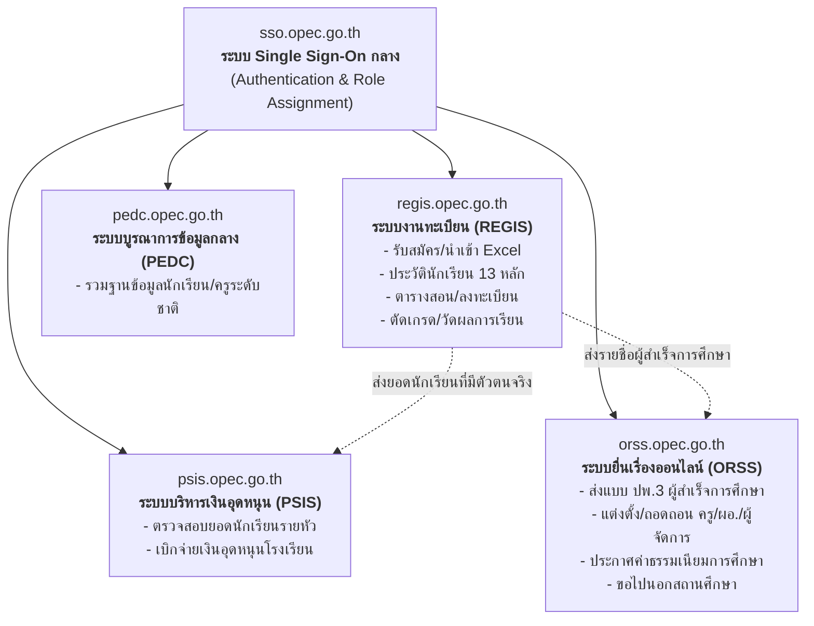
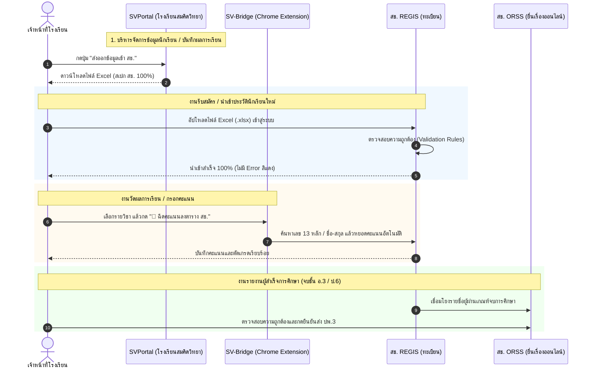

# OPEC Master Knowledge Base | คู่มือและคลังความรู้ระบบ สช. ฉบับสมบูรณ์ (สำหรับน้องฟ้า)

> **เอกสารฉบับนี้จัดทำขึ้นเพื่อ:** เป็นคลังความรู้หลัก (Core Knowledge Base) และ Training Dataset สำหรับ "น้องฟ้า" (AI ประจำโรงเรียนสมคิดวิทยา) ครอบคลุมการวิเคราะห์สถาปัตยกรรมระบบ, โครงสร้างข้อมูล, กฎเกณฑ์การส่งเอกสาร และแนวทางการเชื่อมโยงระบบ (System Integration) เข้ากับระบบของสำนักงานคณะกรรมการส่งเสริมการศึกษาเอกชน (สช.) ทั้งหมด

---

## สารบัญหลัก (Table of Contents)
1. [ภาพรวมระบบนิเวศ สช. (OPEC Digital Ecosystem)](#1-ภาพรวมระบบนิเวศ-สช-opec-digital-ecosystem)
2. [สถาปัตยกรรมและแผนผังการเชื่อมต่อ (System Architecture & Data Flow)](#2-สถาปัตยกรรมและแผนผังการเชื่อมต่อ-system-architecture--data-flow)
3. [แกะระบบที่ 1: ระบบ Single Sign-On กลาง (SSO)](#3-แกะระบบที่-1-ระบบ-single-sign-on-กลาง-sso)
4. [แกะระบบที่ 2: ระบบงานทะเบียน สำหรับโรงเรียนเอกชน (REGIS)](#4-แกะระบบที่-2-ระบบงานทะเบียน-สำหรับโรงเรียนเอกชน-regis)
   * 4.1 สรุปเนื้อหาจากคลิปวิดีโอทุกตอน (YouTube Video Series)
   * 4.2 สรุปชุดคู่มือปฏิบัติงานทางการ (manual21 - manual99)
   * 4.3 สเปกและกฎการนำเข้าไฟล์ Excel (.xlsx) และข้อกำหนด Validation
   * 4.4 สถาปัตยกรรม WebService API ของ REGIS (manual39)
5. [แกะระบบที่ 3: ระบบยื่นเรื่องออนไลน์ (ORSS)](#5-แกะระบบที่-3-ระบบยื่นเรื่องออนไลน์-orss)
   * 5.1 ระบบรายงานผู้สำเร็จการศึกษา (ปพ.3 / รนช.)
   * 5.2 ระบบงานแต่งตั้ง-ถอดถอนบุคลากรทางการศึกษา
   * 5.3 งานตราสาร ใบอนุญาต และค่าธรรมเนียม
   * 5.4 ข้อมูลทางเทคนิค (Endpoints & Parameters)
6. [พิมพ์เขียวการเชื่อมโยงระบบ (Seamless Integration Blueprint for SVPortal)](#6-พิมพ์เขียวการเชื่อมโยงระบบ-seamless-integration-blueprint-for-svportal)
   * 6.1 ตาราง Data Mapping (SVPortal $\rightarrow$ สช. REGIS)
   * 6.2 กลยุทธ์แบบ 3 ระดับ (Excel Generator, SV-Bridge, Automation)
7. [ดัชนีคลังคู่มือฉบับเต็มบนเครื่อง (52 ฉบับ)](#7-ดัชนีคลังคู่มือฉบับเต็มบนเครื่อง-52-ฉบับ)

---

## 1. ภาพรวมระบบนิเวศ สช. (OPEC Digital Ecosystem)

ระบบสารสนเทศของ สช. ถูกออกแบบมาเพื่อให้บริการโรงเรียนเอกชนทั่วประเทศ โดยแบ่งออกเป็น 3 ประตูหลัก:



---

## 2. สถาปัตยกรรมและแผนผังการเชื่อมต่อ (System Architecture & Data Flow)

การนำข้อมูลจากระบบโรงเรียน **SVPortal** เข้าสู่ระบบของ สช. มีจุดเชื่อมโยงดังนี้:



---

## 3. แกะระบบที่ 1: ระบบ Single Sign-On กลาง (SSO)

* **URL ประตูเข้าใช้งาน:** `https://sso.opec.go.th`
* **รูปแบบบัญชีผู้ใช้งาน (Username):** ขึ้นต้นด้วยเครื่องหมาย `@` ตามด้วย **รหัสโรงเรียน** เช่น `@10100001`
* **โครงสร้างการจัดการสิทธิ์ (Role & Permission Hierarchy):**
  1. **Admin School (ผู้ดูแลระบบโรงเรียน):** มีได้เพียง **1 คนต่อ 1 โรงเรียน** เท่านั้น สมัครโดยใช้คำสั่งแต่งตั้งและใบจัดตั้งโรงเรียน อีเมลต้องตรงกับเอกสารแต่งตั้ง
  2. **School Staff (เจ้าหน้าที่โรงเรียน):** Admin School เป็นผู้สร้างบัญชีและมอบหมายสิทธิ์
* **ข้อกำหนดสำคัญ (Sub-Permissions):**
  * เจ้าหน้าที่แต่ละคนจะไม่สามารถเข้าใช้งานระบบย่อยได้ทันที ต้องได้รับ **"การกำหนดสิทธิ์ย่อย"** จาก Admin School ก่อน เช่น ติ๊กถูกที่เมนู `REGIS` หรือ `ORSS`

---

## 4. แกะระบบที่ 2: ระบบงานทะเบียน สำหรับโรงเรียนเอกชน (REGIS)

### 4.1 สรุปเนื้อหาจากคลิปวิดีโอทุกตอน (YouTube Video Series)
จากการวิเคราะห์วิดีโอแนะนำการใช้งานระบบ REGIS ของ สช. มีการแบ่งหมวดหมู่งานออกเป็น:

1. **ระบบจัดการโครงสร้างโรงเรียน & ห้องเรียน:**
   * การสร้างห้องเรียน (เช่น อ.1/1, อ.1/2, ป.1/1)
   * การระบุความจุสูงสุดของแต่ละห้อง
   * การผูก **ครูประจำชั้น** และ **ครูผู้ช่วย** เข้ากับห้องเรียน
2. **ระบบระเบียนนักเรียน (Student Records - EP.1 ถึง EP.2):**
   * การรับสมัครรายบุคคล vs การนำเข้าแบบกลุ่มด้วย Excel
   * การตรวจสอบเลขบัตรประชาชน 13 หลัก
   * การย้ายห้องเรียน, การลาออก, การพักการเรียน, การจำหน่าย
   * การเลื่อนชั้นเรียนประจำปี (Grade Promotion แบบรายห้อง/รายชั้น)
   * การนำเข้ารูปถ่ายนักเรียนแบบรายกลุ่ม (Batch Photo Upload)
3. **ระบบบริหารหลักสูตรและตารางสอน:**
   * การสร้างโครงสร้างหลักสูตรและรายวิชาตามกลุ่มสาระการเรียนรู้
   * การกำหนดตารางเรียน-ตารางสอน
4. **ระบบวัดผลการเรียน (EP.1 ถึง EP.3):**
   * การบันทึกคะแนนระหว่างภาคและปลายภาค
   * การประมวลผลคะแนน, การตัดเกรด, และการคิด GPA/GPAX
5. **ระบบสำเร็จการศึกษา (EP.1 ถึง EP.2):**
   * การอนุมัติผลการเรียนผู้สำเร็จการศึกษา
   * การออกเอกสาร ปพ.3 เพื่อส่งต่อข้อมูลไปยังระบบ ORSS
6. **ระบบเงินอุดหนุน:**
   * การตรวจสอบยืนยันตัวตนนอกจากทะเบียน เพื่อส่งต่อยอดนักเรียนไปยังระบบ PSIS

---

### 4.2 สรุปชุดคู่มือปฏิบัติงานทางการ (manual21 - manual99)
คู่มือทั้ง 21 เล่มที่จัดเก็บไว้ใน `knowledge-base/opec/regis/` มีเนื้อหาเฉพาะทางดังนี้:

| เล่ม | จำนวนหน้า | สาระสำคัญ |
| :---: | :---: | :--- |
| **manual21** | 35 | **ระบบบริหารจัดการหลักสูตร:** การสร้างหลักสูตรสถานศึกษา, รหัสวิชา, หน่วยกิต, โครงสร้างเวลาเรียน |
| **manual22** | 168 | **ระบบระเบียนนักเรียน (เล่มหลัก):** การนำเข้า Excel, กฎเกณฑ์ข้อมูล 13 หลัก, การย้ายเข้า-ออก, เลื่อนชั้น, การจัดการข้อมูลผู้ปกครอง |
| **manual23** | 44 | **ระบบตารางเรียนตารางสอน:** การจัดตารางสอนครู, คาบเรียน, ห้องเรียน |
| **manual24** | 22 | **ระบบลงทะเบียนเรียน:** การนำนักเรียนเข้าสู่รายวิชาที่เปิดสอน |
| **manual25** | 78 | **ระบบบริหารจัดการบุคลากร:** ข้อมูลครู, วุฒิการศึกษา, ใบอนุญาตประกอบวิชาชีพครู |
| **manual26** | 74 | **ระบบวัดผลการเรียน:** การคำนวณคะแนน, ตัดเกรด, แก้ไขคะแนน, การส่งผลการเรียน |
| **manual27** | 48 | **ระบบสำเร็จการศึกษา:** รายละเอียดการออก ปพ.3 แบบอิเล็กทรอนิกส์ |
| **manual28** | 49 | **ระบบจัดการข้อมูลโรงเรียน:** พื้นที่, อาคาร, ห้องปฏิบัติการ, ข้อมูลพื้นฐานสถานศึกษา |
| **manual29** | 16 | **ระบบรายงาน SAR:** การส่งรายงานประกันคุณภาพภายใน |
| **manual31-33**| 57 | **พอร์ทัลผู้ใช้:** ครูผู้สอน (31), ครูประจำชั้น (32), และการจัดการสิทธิ์เจ้าหน้าที่ (33) |
| **manual37-38**| 53 | **ระบบ GPA/GPAX และตรวจสอบความซ้ำซ้อน:** การคัดกรองนักเรียนซ้ำซ้อนข้ามโรงเรียน |
| **manual39** | 9 | **การเชื่อมโยงระบบ (API Service):** โครงสร้าง WebService API สำหรับหน่วยงานภายนอก |
| **manual40-52**| 156 | **ระบบเงินอุดหนุน (4 เล่ม):** การตรวจสอบสิทธิ์นักเรียนรายหัวและการเบิกจ่ายเงินอุดหนุน |
| **manual98-99**| 261 | **สถาปัตยกรรมระบบส่วนกลาง & MIS:** คู่มือระดับแอดมินและการตั้งค่าระบบแม่ข่าย |

---

### 4.3 สเปกและกฎการนำเข้าไฟล์ Excel (.xlsx) และข้อกำหนด Validation

จากการวิเคราะห์ `manual22.pdf` (หน้า 41–48) และระบบของ สช.:

#### 1. ฟอร์แมตและนามสกุลไฟล์
* ต้องเป็นไฟล์ **Excel (.xlsx)** เท่านั้น
* รองรับ 2 แท็บ/โหมด: **นักเรียนไทย (มีเลข 13 หลัก)** และ **นักเรียนต่างชาติ (G-Code)**

#### 2. กฎการจัดรูปแบบวันที่ (CRITICAL RULE ⚠️)
* สช. ได้ออกประกาศปรับฟอร์แมตวันที่ใหม่:
  * ❌ **ห้ามใช้:** วัน/เดือน/ปี เช่น `14/05/2569`
  * ✅ **ต้องใช้:** **ปีเดือนวัน (พ.ศ.) ติดกัน 8 หลัก (`ปปปปดดวว`)** เช่น วันที่ 14 พฤษภาคม 2569 ต้องเขียนเป็น **`25690514`**

#### 3. กฎ 7 ข้อในการตรวจสอบข้อมูล (Validation Rules) ของ สช.:
1. **รหัสเพศ:** ต้องตรงตามรหัสมาตรฐานกระทรวงศึกษาธิการ (`1` = ชาย, `2` = หญิง)
2. **เลขประจำตัวประชาชน 13 หลัก:** ต้องผ่าน Modulo 11 Checksum และไม่ว่าง
3. **ตรวจสอบฐานข้อมูลกลางกระทรวง (สป.ศธ.):** ระบบ สช. จะยิงตรวจสอบเลข 13 หลักกับฐานข้อมูลสำนักงานปลัดกระทรวงศึกษาธิการทันที
4. **ความซ้ำซ้อนภายในโรงเรียน:** นักเรียนต้องไม่มีเลขประจำตัวซ้ำในโรงเรียนเดียวกัน
5. **ความซ้ำซ้อนในไฟล์ Excel:** ห้ามมีข้อมูลนักเรียนซ้ำแถวกันในไฟล์ที่อัปโหลด
6. **ความซ้ำซ้อนข้ามโรงเรียน:** หากเด็กมีชื่ออยู่ในโรงเรียนเอกชนอื่น ระบบจะแจ้งเตือนเป็น "นักเรียนซ้ำซ้อน" และต้องทำการยืนยัน/จำหน่ายออกจากที่เดิมก่อน
7. **รหัสคำนำหน้าชื่อ และ สัญชาติ:** ต้องตรงตามตารางรหัสมาตรฐานกระทรวง

---

### 4.5 ระบบสารสนเทศด้านการประกันคุณภาพการศึกษา (e-SAR) และรายงานผลการประเมินตนเอง

* **URL ระบบ:** `https://esar.opec.go.th`
* **ความสัมพันธ์กับ REGIS (manual29):** REGIS มีโมดูลสำหรับส่งออกข้อมูลสารสนเทศพื้นฐาน, สถิตินักเรียน, ครู, และผลสัมฤทธิ์ทางการเรียน ไปยังระบบ e-SAR เพื่อใช้เป็นข้อมูลประกอบการประเมินคุณภาพภายใน
* **เอกสารอ้างอิงจริงในคลังความรู้:**
  * ไฟล์: `knowledge-base/opec/esar/1121100013_sar_2568_complete.pdf` (ความยาว 93 หน้า)
  * เป็น **รายงานการประเมินตนเอง (SAR) ประจำปีการศึกษา 2568 ของโรงเรียนสมคิดวิทยา (รหัส 1121100013)** ฉบับสมบูรณ์
* **โครงสร้างรายงาน e-SAR (3 มาตรฐานหลัก):**
  1. **มาตรฐานที่ 1 คุณภาพของเด็ก / ผู้เรียน:** (ระดับยอดเยี่ยม) พัฒนาการด้านร่างกาย, อารมณ์-จิตใจ, สังคม, สติปัญญา, ผลสัมฤทธิ์ทางการเรียน, ผลการทดสอบระดับชาติ (RT / NT / O-NET)
  2. **มาตรฐานที่ 2 กระบวนการบริหารและการจัดการ:** โครงสร้างการบริหาร, การจัดครูให้พอเพียงและเชี่ยวชาญ, สภาพแวดล้อมที่เอื้อต่อการเรียนรู้, รูปแบบ FBM & SBM (Family & School-Based Management)
  3. **มาตรฐานที่ 3 กระบวนการจัดการเรียนการสอนที่เน้นผู้เรียนเป็นสำคัญ:** การจัดประสบการณ์ Active Learning, การประเมินพัฒนาการตามสภาพจริง, PLC ชุมชนแห่งการเรียนรู้ทางวิชาชีพครู

### 4.4 สถาปัตยกรรม WebService API ของ REGIS (manual39)

จากคู่มือ `manual39.pdf` พบว่า สช. มีระบบ **REGIS API Service** รองรับการเชื่อมต่อกับระบบภายนอก:
* **ระบบความปลอดภัย:** ใช้ระบบยืนยันตัวตนด้วย Username/Password ร่วมกับ **IP Whitelisting** (ต้องลงทะเบียน IP เซิร์ฟเวอร์ที่เรียกใช้งานล่วงหน้า)
* **การจัดการ Service:** มีเมนู `รายการ Service API` และการกำหนด `สิทธิ์การใช้งาน API` รายหน่วยงาน
* **การตรวจสอบ:** มีระบบบันทึกประวัติ `ประวัติการเข้าใช้งาน API (Access Log)` ทุก Request

---

## 5. แกะระบบที่ 3: ระบบยื่นเรื่องออนไลน์ (ORSS)

* **URL ประตูเข้าใช้งาน:** `https://orss.opec.go.th`
* **เทคโนโลยีเบื้องหลัง:** Java Spring MVC + JSP (`.htm?mode=...`) + AdminLTE 3.2
* **Session Timeout:** 60 นาที (มีการตัดอัตโนมัติหากไม่เคลื่อนไหว)

### 5.1 ระบบรายงานผู้สำเร็จการศึกษา (ปพ.3 / รนช.)
* เมนู: `OpecStudentGraduate.htm?mode=init`
* เป็นช่องทางที่โรงเรียนต้องยื่นรายชื่อนักเรียนที่จบการศึกษา (อ.3, ป.6) อย่างเป็นทางการ เพื่อให้ สช. ออกเลขและรับรองประกาศนียบัตร
* **ขั้นตอน:** ตรวจสอบรายชื่อที่ผ่านเกณฑ์จากระบบ REGIS $\rightarrow$ บันทึกเลขที่ ปพ.3 $\rightarrow$ แนบไฟล์เอกสารเสนอ $\rightarrow$ เสนอลงนาม $\rightarrow$ ออกเลขสารบรรณ

### 5.2 ระบบงานแต่งตั้ง-ถอดถอนบุคลากรทางการศึกษา
ครอบคลุม 6 ตำแหน่งหลัก โดยมีขั้นตอน:
1. แนบเอกสารคำสั่งแต่งตั้ง / สำเนาใบอนุญาตจัดตั้ง / วุฒิการศึกษา
2. บันทึกข้อมูลและประวัติลงในระบบ
3. รหัสสถานะการดำเนินงาน (Status Lifecycle):
   * `A` : รอแนบเอกสาร
   * `B` : ยืนยันการส่งคำร้อง (รอตรวจสอบเอกสาร)
   * `C` : แจ้งกลับให้แก้ไขเอกสาร
   * `F` : อยู่ระหว่างเสนอลงนาม
   * `H` : ดำเนินการเรียบร้อย (อนุมัติ)

### 5.3 งานตราสาร ใบอนุญาต และค่าธรรมเนียม
---

## 6. แกะระบบที่ 4: ระบบบริหารจัดการเงินอุดหนุน (PSIS)

* **URL ประตูเข้าใช้งาน:** `https://psis.opec.go.th`
* **ผู้พัฒนาระบบ:** บริษัท จีที เทคโนโลยี่ จำกัด (คู่มืออ้างอิง: `knowledge-base/opec/psis/PSIS_MANUAL_GUIDE.md`)
* **ความเชื่อมโยงกับ SVPortal:** การกระทบยอดนักเรียนที่มีสิทธิ์รับเงินอุดหนุน และการส่งข้อมูลโภชนาการ

### 6.1 รายงานทางการเงินที่โรงเรียนต้องยื่น (อน. และ อร.)
1. **รายงาน อน.1 (ประจำปี):** คำร้องขอรับเงินอุดหนุนรายบุคคลของนักเรียนในโรงเรียนเอกชน (แบ่งตามระดับชั้น: ก่อนประถม, ประถม, มัธยม) พร้อมสรุปยอดเงินรวม
2. **รายงาน อน.4 (ประจำเดือน):** ใบสำคัญรับเงินอุดหนุนรายบุคคล ที่ สช. โอนเข้าบัญชีธนาคารกรุงไทยของโรงเรียน พร้อมรายงานหลักฐานการจ่ายเงินเดือนครูไม่ต่ำกว่าเกณฑ์
3. **แบบ อร.1 และ อร.1/1 (ประจำไตรมาส):** เงินอุดหนุนเรียนฟรี 15 ปี (ค่าหนังสือเรียน, ค่าอุปกรณ์การเรียน, ค่าเครื่องแบบนักเรียน, และค่ากิจกรรมพัฒนาคุณภาพผู้เรียน)

### 6.2 การบันทึกข้อมูลเฉพาะทาง (Special Subsidies)
1. **ค่าอาหารกลางวัน (นักเรียนทุพโภชนาการ):** บันทึก **ส่วนสูง (ซม.)** และ **น้ำหนัก (กก.)** เพื่อประเมินเกณฑ์ภาวะโภชนาการ
2. **ค่าอาหารกลางวัน (นักเรียนขาดแคลน):** คัดกรองครอบครัวที่มีรายได้รวม **ไม่เกิน 40,000 บาทต่อปี**
3. **เงินอุดหนุนครูสอนนักเรียนพิการ:** ค่าตอบแทนพิเศษ **2,500 บาทต่อเดือน** (ต้องมีวุฒิการศึกษาพิเศษ หรือผ่านการอบรม กคศ.)

---

## 7. พิมพ์เขียวการเชื่อมโยงระบบ (Seamless Integration Blueprint for SVPortal)

เพื่อให้โรงเรียนสมคิดวิทยาทำงานได้แบบ **Seamless ที่สุด (กรอกครั้งเดียว ข้อมูลวิ่งไปทุกระบบ)** เราวางพิมพ์เขียวไว้ดังนี้:

### 6.1 ตาราง Data Mapping (จาก `students_data.csv` ใน SVPortal $\rightarrow$ ฟอร์แมต สช.)

| ข้อมูลใน SVPortal | คอลัมน์ที่ สช. ต้องการ | กฎการแปลงข้อมูล (Transformation Rule) |
| :--- | :--- | :--- |
| `เลขประจำตัวนักเรียน` | รหัสนักเรียน | สตริงตัวเลข ไม่เกิน 10 หลัก |
| `เลขประจำตัวประชาชน` | เลข 13 หลัก | สตริงตัวเลข 13 หลัก (ตัดขีด `-` ออก) |
| `คำนำหน้าชื่อ` | รหัสคำนำหน้า / คำนำหน้า | แปลง `ด.ช.` $\rightarrow$ `เด็กชาย`, `ด.ญ.` $\rightarrow$ `เด็กหญิง` |
| `ชื่อ` | ชื่อ (ภาษาไทย) | ตัดเว้นวรรคส่วนเกิน |
| `นามสกุล` | นามสกุล (ภาษาไทย) | ตัดเว้นวรรคส่วนเกิน |
| `เพศ` | รหัสเพศ | ชาย $\rightarrow$ `1`, หญิง $\rightarrow$ `2` |
| `วันเกิด` (เช่น `17 ต.ค. 2565`) | วันเดือนปีเกิด | **แปลงเป็น `ปปปปดดวว`** เช่น `25651017` ⭐ |
| `สัญชาติ` | รหัสสัญชาติ | สัญชาติไทย $\rightarrow$ `099` (หรือตามรหัสมาตรฐานกระทรวง) |
| `ศาสนา` | ศาสนา | พุทธ, คริสต์, อิสลาม |
| `ชั้นเรียน` (เช่น `อ.1/1`) | ระดับชั้น / ห้อง | แยกระดับชั้น (`อ.1`) และห้อง (`1`) |
| `ที่อยู่` (บ้านเลขที่, หมู่, ตำบล, อำเภอ, จังหวัด) | ข้อมูลที่อยู่ตามทะเบียนบ้าน | แมปตามคอลัมน์มาตรฐาน สช. |
| `[บิดา] เลขประจำตัวประชาชน` | เลข 13 หลัก บิดา | 13 หลัก ตรวจสอบความถูกต้อง |
| `[มารดา] เลขประจำตัวประชาชน` | เลข 13 หลัก มารดา | 13 หลัก ตรวจสอบความถูกต้อง |
| `[ผู้ปกครอง] ข้อมูล` | ข้อมูลผู้ปกครอง | แมปความสัมพันธ์ (บิดา/มารดา/อื่นๆ) |

---

### 6.2 กลยุทธ์แบบ 3 ระดับ (3-Tier Strategy)

```
┌────────────────────────────────────────────────────────┐
│  Tier 1: SVPortal One-Click Excel Generator (ทันที)    │
│  - เพิ่มปุ่ม [ส่งออก Excel สำหรับ สช. REGIS] ใน SVPortal│
│  - แปลงวันที่เป็น ปปปปดดวว และจัดคอลัมน์ตรง 100%       │
│  - ผลลัพธ์: โหลดไฟล์แล้วอัปโหลดเข้า สช. ได้ทันทีโดยไม่ Error│
└────────────────────────────────────────────────────────┘
                           │
                           ▼
┌────────────────────────────────────────────────────────┐
│  Tier 2: SV-Bridge Chrome Extension (ยกระดับ)         │
│  - ต่อยอดจากส่วนขยายที่ฉีดคะแนนเดิม                   │
│  - เพิ่มแท็บ: "ฉีดข้อมูลนักเรียนใหม่" และ "ตรวจสอบ ปพ.3"│
│  - ผลลัพธ์: กดคลิกเดียวบนเบราว์เซอร์ ข้อมูลกรอกลงฟอร์มทันที│
└────────────────────────────────────────────────────────┘
                           │
                           ▼
┌────────────────────────────────────────────────────────┐
│  Tier 3: Backend Automation / API Direct Sync (ถาวร)  │
│  - เชื่อมต่อผ่าน REGIS WebService API (ตาม manual39)  │
│  - ซิงก์ข้อมูลนักเรียนและผลการเรียนอัตโนมัติตามรอบเวลา   │
└────────────────────────────────────────────────────────┘
```

---

## 7. ดัชนีคลังคู่มือฉบับเต็มบนเครื่อง (52 ฉบับ)

ไฟล์ต้นฉบับทั้งหมดถูกจัดเก็บไว้อย่างถาวรในโฟลเดอร์โปรเจกต์:
`file:///Users/peerawatsmacbookpro/Documents/SVPortal-Post/knowledge-base/opec/`

* **โฟลเดอร์ REGIS (21 ฉบับ):** [`knowledge-base/opec/regis/`](file:///Users/peerawatsmacbookpro/Documents/SVPortal-Post/knowledge-base/opec/regis)
* **โฟลเดอร์ ORSS (27 ฉบับ):** [`knowledge-base/opec/orss/`](file:///Users/peerawatsmacbookpro/Documents/SVPortal-Post/knowledge-base/opec/orss)
* **โฟลเดอร์ SSO (4 ฉบับ):** [`knowledge-base/opec/sso/`](file:///Users/peerawatsmacbookpro/Documents/SVPortal-Post/knowledge-base/opec/sso)

*(เมื่อต้องการให้น้องฟ้าเรียนรู้หัวข้อใด สามารถอ้างอิงไฟล์ PDF และเนื้อหาในรายงานฉบับนี้ได้โดยตรง)*
