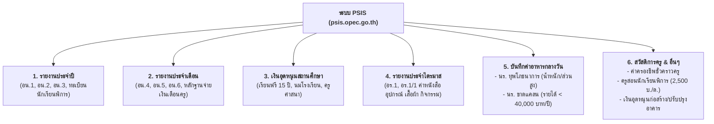

# คู่มือระบบบริหารจัดการงบประมาณเงินอุดหนุน (PSIS)
> **เอกสารอ้างอิง:** โครงการปรับปรุงและพัฒนาระบบสารสนเทศสถานศึกษาเอกชน เพื่อบริหารงบประมาณเงินอุดหนุน (การใช้งานระบบสำหรับโรงเรียน)  
> **หน่วยงาน:** สำนักงานคณะกรรมการส่งเสริมการศึกษาเอกชน (สช.)  
> **ผู้พัฒนาระบบ:** บริษัท จีที เทคโนโลยี่ จำกัด  
> **URL ระบบ:** `https://psis.opec.go.th`

---

## 1. ภาพรวมและบทบาทของระบบ PSIS
ระบบ **PSIS (Private School Information System)** คือระบบหัวใจหลักด้าน **"การเงินและงบประมาณเงินอุดหนุนจากภาครัฐ"** ของโรงเรียนเอกชน 
* ข้อมูลนักเรียนที่มีตัวตนจริงจากระบบ **REGIS** จะถูกส่งต่อ/เชื่อมโยงมายัง **PSIS** เพื่อใช้ในการคำนวณและเบิกจ่ายเงินอุดหนุนประเภทต่างๆ
* โรงเรียนมีหน้าที่ตรวจสอบยอด, บันทึกข้อมูลเงื่อนไขเฉพาะ (เช่น ภาวะทุพโภชนาการ, ฐานะยากจน), และจัดพิมพ์เอกสารแบบรายงานทางการเงิน (อน. และ อร.) เสนอต่อสำนักงานศึกษาธิการจังหวัด/สช.

---

## 2. โครงสร้างเมนูและ Workflow งานในระบบ PSIS (11 หมวด)

---

## 3. รายละเอียดแบบรายงานทางการเงินที่สำคัญ

### 3.1 หมวดรายงานประจำปี (อน.1 - อน.3)
* **รายงาน อน.1 (คำร้องขอรับเงินอุดหนุนรายบุคคล):**
  * สรุปจำนวนนักเรียนตามความจุสูงสุด, จำนวนนักเรียนจริงในโรงเรียน, และจำนวนนักเรียนที่มีสิทธิ์ขอรับเงินอุดหนุน
  * แยกตามระดับชั้น: ก่อนประถมศึกษา, ประถมศึกษา, มัธยมศึกษาตอนต้น, มัธยมศึกษาตอนปลาย
  * แสดงอัตราเงินอุดหนุนรายบุคคลต่อปี และรวมจำนวนเงินที่ขอรับ
  * ต้องลงนามโดย: **ผู้จัดการ, ผู้อำนวยการ, และผู้รับใบอนุญาต/ผู้แทน**

### 3.2 หมวดรายงานประจำเดือน (อน.4 - อน.6)
* **รายงาน อน.4 (ใบสำคัญรับเงินอุดหนุนรายบุคคล):**
  * สรุปยอดเงินอุดหนุนที่โรงเรียนได้รับโอนจาก สช. เข้าบัญชีธนาคารกรุงไทยในแต่ละเดือน
  * ระบุจำนวนนักเรียนปกติ และนักเรียนพิการ พร้อมยอดเงินรวมสุทธิ
* **หลักฐานการจ่ายเงินเดือนครูและเจ้าหน้าที่:**
  * รายงานยืนยันการนำเงินอุดหนุนไปจ่ายเป็นเงินเดือนครูไม่ต่ำกว่าอัตราขั้นต่ำที่กระทรวงศึกษาธิการกำหนด

### 3.3 หมวดรายงานประจำไตรมาส (โครงการสนับสนุนค่าใช้จ่ายการศึกษาขั้นพื้นฐาน 15 ปี)
* **แบบ อร.1 (คำขอรับการอุดหนุน 4 หมวด):**
  1. ค่าหนังสือเรียน
  2. ค่าอุปกรณ์การเรียน
  3. ค่าเครื่องแบบนักเรียน
  4. ค่ากิจกรรมพัฒนาคุณภาพผู้เรียน
* **แบบ อร.1/1 (ใบสำคัญรับเงินอุดหนุน 4 หมวด):**
  * สรุปยอดเงินที่เบิกจ่ายจริงตามจำนวนนักเรียนที่ลงทะเบียน

---

## 4. ระบบบันทึกข้อมูลเฉพาะทาง (Special Data Inputs)

### 4.1 บันทึกค่าอาหารกลางวัน (หน้า 11–12)
โรงเรียนต้องคัดกรองนักเรียนออกเป็น 2 กลุ่ม:
1. **นักเรียนทุพโภชนาการ (Malnutrition):**
   * บันทึกข้อมูล: **ส่วนสูง (ซม.)** และ **น้ำหนัก (กก.)** ของนักเรียนแต่ละคน
   * ระบบจะประมวลผลดัชนีมวลกายเทียบเกณฑ์มาตรฐาน (เช่น อยู่ในเกณฑ์, เริ่มเตี้ย, ผอม, ทุพโภชนาการ)
2. **นักเรียนขาดแคลน (Underprivileged):**
   * เกณฑ์: **ครอบครัวมีรายได้รวมไม่เกิน 40,000 บาทต่อปี**
   * ตัวเลือกสถานะ: "นักเรียนที่มีฐานะยากจน" หรือ "ไม่มีเงินมาทานอาหารกลางวัน"

### 4.2 เงินอุดหนุนครูสอนนักเรียนพิการ (หน้า 16–17)
* ค่าตอบแทนพิเศษ: **2,500 บาทต่อเดือน**
* คุณสมบัติที่ต้องระบุ:
  * วุฒิปริญญาตรี การศึกษาพิเศษ หรือ
  * ประกาศนียบัตรทางการศึกษา หรือเทียบเท่า หรือ
  * ผ่านการอบรมผู้ปฏิบัติงานด้านการสอนคนพิการ (กคศ. รับรอง)
* ข้อมูลการเบิกจ่าย: บัญชีธนาคาร และเลขที่บัญชี

---

## 5. การเชื่อมโยงข้อมูลกับ SVPortal (Integration Points for SVPortal)

| ข้อมูลใน SVPortal | ฟังก์ชันใน PSIS ที่นำไปใช้ | ประโยชน์ต่อโรงเรียน |
| :--- | :--- | :--- |
| **น้ำหนัก & ส่วนสูง** | เมนูบันทึกค่าอาหารกลางวัน (ข้อ 6.1) | ปลั๊กค่าน้ำหนักส่วนสูงจากการตรวจสุขภาพเทอมละครั้ง เข้า PSIS อัตโนมัติ ไม่ต้องกรอกซ้ำ |
| **ข้อมูลรายได้ครอบครัว** | เมนูนักเรียนขาดแคลน (ข้อ 6.2) | ดึงข้อมูลรายได้บิดา-มารดาจาก `students_data` เพื่อคัดกรองเด็กที่ได้สิทธิ์อาหารกลางวัน |
| **ยอดจำนวนนักเรียนรายห้อง** | ตรวจสอบยอด อน.1 และ อร.1 | กระทบยอดนักเรียนใน SVPortal กับยอดคำนวณเงินอุดหนุนของ สช. ป้องกันเงินตกหล่น |
| **เงินเดือนและวุฒิครู** | รายงานการจ่ายเงินเดือนครู (อน.4) | สรุปรายงานเงินเดือนครูส่ง สช. |
